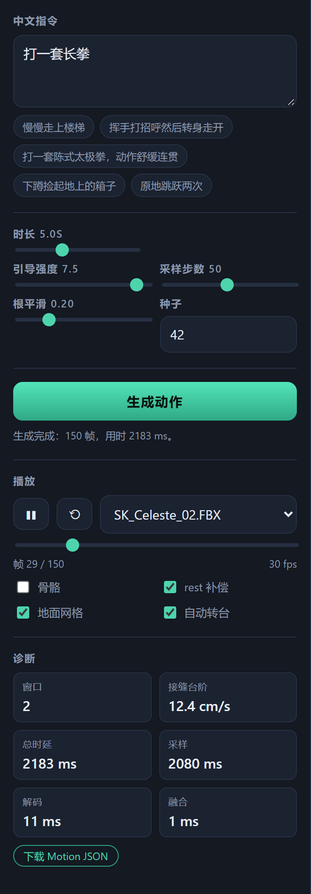
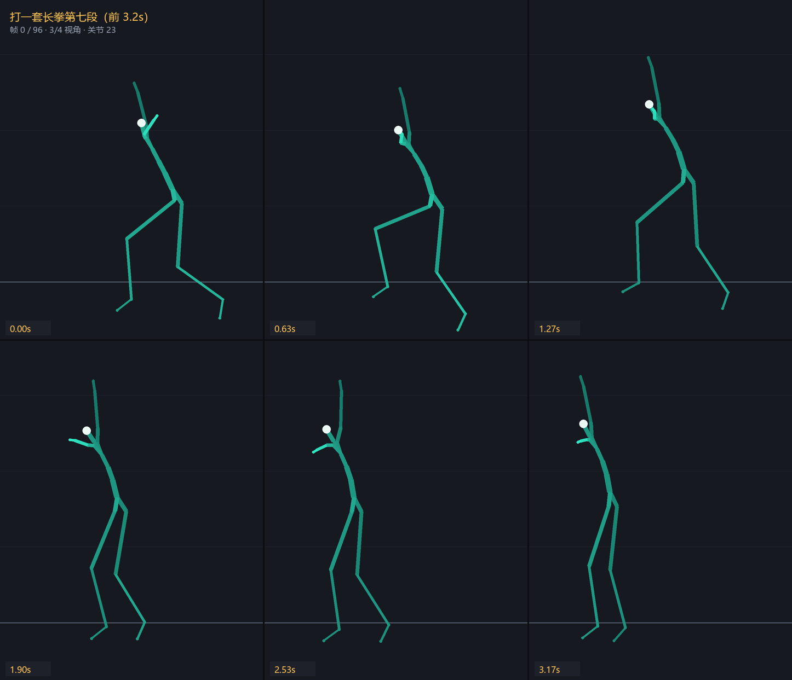
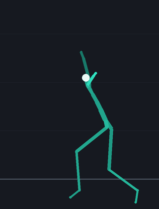
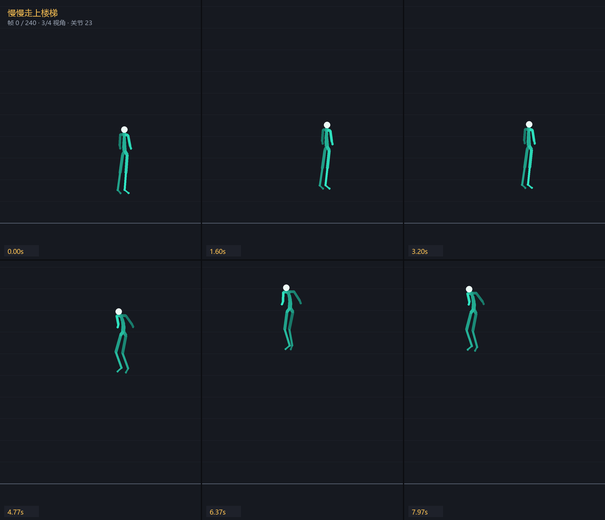
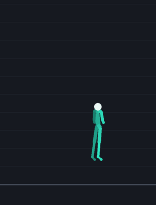

# TTM — 中文文本驱动骨骼动作生成系统

> 用一句中文（"慢慢走上楼梯" / "扫地" / "打一套长拳"）生成 5 秒以上连贯骨骼动画，
> 浏览器实时预览本地 FBX，一键导出 BVH / UE 动画。
> **可自己训练**：喂进你自己的 BVH 动作库，从零训出模型。

| 项 | 内容 |
|---|---|
| 项目根 | `D:/TTM`（**唯一可写盘**；`Z:` 只读；`C:` 零写入） |
| Python | `D:/TTM/.venv/Scripts/python.exe`（3.13.12） |
| 数据源 | `Z:/1000hours/BVH_Body`（26,157 个 BVH）+ `Z:/1000hours/4.wushu`（220 个） |
| 骨架 | 23 关节（BVH）/ 22 骨 + `root`（UE），一一同构 |
| 特征 | **146 维** / 帧，30 fps，150 帧窗口 → VAE 下采样 4× → **38 tokens**，latent 128 |
| 文本编码 | `BAAI/bge-small-zh-v1.5`（**本地离线**，`models/bge-small-zh-v1.5`，CLS 池化 + L2） |
| 扩散 | DiT 8 层 / d_model 256 / 8 heads，DDIM η=0，CFG `guidance=7.5`（四点 sweep 定案，见已知限制 2） |
| 文档 | `deliverables/software-company/TTM-PRD.md`、`TTM-ARCH.md` |

---

## 效果图

### 运行界面

本地服务 `uvicorn server.app:app` 起在 `127.0.0.1:8765`，浏览器打开即是这个控制台
（截图取自真实页面，输入「打一套长拳」后 2035ms 返回 150 帧）：



从输入到播放的链路：中文指令 → bge 文本编码 → DiT 采样（CFG 7.5 / DDIM 50 步）→
MotionVAE 解码 146 维特征 → 滑窗融合 → 23 关节骨架 → three.js 播放 / BVH 下载。
面板下方「诊断」实时回显本次的窗口数、接缝台阶、采样/解码/融合耗时，方便定位慢在哪一段。

### 动作效果

下图由 `tools/render_motion_figures.py` 从**导出的 Motion JSON** 直接做正向运动学渲染
（读 `skeleton.bones` 的 parent + rest_offset_cm，3/4 视角正交投影），不经过浏览器，
因此不依赖角色网格资产。

**「打一套长拳」（前 3.2 秒，6 帧分解）** — 起势 → 弓步推掌 → 转身：





**「慢慢走上楼梯」（全程 8 秒）** — 抬腿、落步、重心上移，逐级爬升：





> 重新生成这些图：`python tools/render_motion_figures.py --range 0:96`
> （`--range` 只对第一条指令生效；留空则整片）

---

## 1. 环境准备（一次性）

```powershell
# ① 注入环境变量（缓存/临时目录全部重定向到 D:/TTM/.cache，保证 C 盘零写入）
. D:/TTM/scripts/env.ps1        # PowerShell
# source D:/TTM/scripts/env.sh  # 或 bash / Git-Bash

# ② 安装精确锁定的依赖（torch 走 cu128 通道，其它走 PyPI）
python -m pip install -r requirements.lock.txt `
    --index-url https://download.pytorch.org/whl/cu128 `
    --extra-index-url https://pypi.org/simple

# ③ 自检（退出码 0 即通过；--strict 要求 CUDA 可用）
python scripts/00_env_check.py
```

`00_env_check.py` 会验证：解释器位置、`PIP_CACHE_DIR/HF_HOME/TORCH_HOME/TMPDIR` 全部指向
`D:/TTM/.cache`、写盘守卫拒绝 `C:`/`Z:`、真实写探针全部落在 D 盘（**C 盘零写入**）、
依赖可 import、`torch.cuda` 可用并能跑一次 GPU 矩阵乘。

> **禁止联网**：bge 权重已随仓库下发到 `models/bge-small-zh-v1.5/`（92 MB / 9 文件）。
> `TextEncoder` 会显式设置 `TRANSFORMERS_OFFLINE=1 / HF_HUB_OFFLINE=1` 并以
> `local_files_only=True` 加载，**不会**访问 HuggingFace Hub。

---

## 2. 全流程六条命令

```powershell
. D:/TTM/scripts/env.ps1

python scripts/01_scan.py            --config configs/tier_s.yaml   # 扫描 + 去重 + 8:1:1 切分 → index.jsonl
python scripts/02_preprocess.py      --config configs/tier_s.yaml   # 146 维特征 → shards/*.npz + labels.jsonl + norm_stats.npz
python scripts/03_train_vae.py       --config configs/tier_s.yaml   # MotionVAE → runs/tier_s/vae/best.pt
python scripts/04_train_diffusion.py --config configs/tier_s.yaml   # 潜空间扩散 → runs/tier_s/diffusion/best.pt
python scripts/05_generate.py        --config configs/tier_s.yaml   # 生成 3 条指令的 BVH → deliverables/generated/
python scripts/06_smoke_e2e.py       --config configs/tier_s.yaml --write-perf   # 端到端冒烟 + 性能报告
```

启动推理服务 + 网页预览：

```powershell
python -m uvicorn server.app:app --host 127.0.0.1 --port 8765
# 打开 http://127.0.0.1:8765/      （网页）
# 打开 http://127.0.0.1:8765/docs  （OpenAPI 文档）
```

小样本调试（不要全量扫 26,157 个文件）：

```powershell
python scripts/01_scan.py       --config configs/smoke.yaml --limit 200
python scripts/02_preprocess.py --config configs/smoke.yaml --limit 50
```

> `Z:` 是慢速网络盘：扫描/预处理全部**单趟顺序读**，并支持 `--limit N`。
> 产物全落 D 盘，训练与推理**零次触碰 Z 盘**。

---

## 3. 目录结构

```
D:/TTM/
├── configs/            default.yaml / smoke.yaml / tier_s.yaml
├── src/ttm/
│   ├── common/         paths(写盘守卫) logutil seed config constants
│   ├── data/           skeleton bvh scan features labels_zh preprocess dataset
│   ├── models/         vae text_encoder diffusion
│   ├── train/          train_vae train_diffusion
│   ├── infer/          sampling(DDIM+滑窗) blend(融合+根连续化) generate(编排+计时)
│   └── export/         bvh_io(内部骨架 BVH) retarget(UE 重定向 + Motion JSON)
├── scripts/            env.ps1 env.sh 00_env_check 01_scan 02_preprocess
│                      03_train_vae 04_train_diffusion 05_generate
│                      06_smoke_e2e 07_dataset_stats
├── server/app.py       FastAPI：/health /prompts /generate /motions /characters /docs
├── web/                index.html + app.js + style.css（CDN ESM three.js，零构建链）
├── tools/ue_import.py  Motion JSON → UE 可导入的 BVH + import_unreal.py + manifest
├── tests/              pytest 单测（离线可跑，不依赖 Z 盘）
├── models/             bge-small-zh-v1.5（离线权重）
├── runs/tier_<档位>/   vae/ diffusion/ 训练产物；logs/ 长任务日志；api/ 服务产物
├── data/tier_<档位>/   index.jsonl labels.jsonl norm_stats.npz shards/*.npz
├── deliverables/       PRD / ARCH / generated/*.bvh / ue/ / perf_report.md
└── .cache/             pip/HF/torch/tmp 全部重定向至此（gitignore）
```

> **档位隔离**：`TTMConfig.run_dir()` 返回 `runs/tier_<tier 小写>/<name>`，
> 因此 `configs/smoke.yaml` 的冒烟权重不会覆盖正式档（早前 `runs/vae` 的写法会互相踩）。

---

## 4. 关键契约（改代码前必读）

1. **旋转**：内部统一 **6D**（旋转矩阵前两行）；导出统一四元数 **xyzw**；BVH 欧拉序 **YXZ、
   角度制**，只在解析边界处理一次。
2. **坐标系**：内部 **BVH 系（Y-up / 右手 / cm）**。唯一轴向/骨架换名的地方是
   `src/ttm/export/retarget.py`；前端 `web/app.js` 只做「rest pose delta + 归一化缩放」，
   **Python 不解析 FBX**。
3. **特征 146 维**布局 = `ttm/common/constants.py::FEAT_LAYOUT`（唯一实现处），
   带 `layout_version=1` 写入 `norm_stats.npz` 与 Motion JSON。
4. **一切落盘路径**必须经 `ttm.common.paths.resolve_out()`（写盘守卫）。
5. **一切随机性**必须经 `ttm.common.seed.set_seed()`。
6. **JSONL** 用 orjson 逐行读写；npz 字段名/dtype 见 ARCH §5.5，不得增删字段。
7. **坏文件**：捕获 → `failed.jsonl` → 计数 → 继续，绝不因单文件失败退出。
8. **数据质量守卫**（T04 实测新增，见 `ttm/data/features.py`）：
   - 首帧若是「全 0 旋转」的 T-pose 占位帧，`trim_placeholder_frames()` 会裁掉它
     （实测该帧与第 2 帧之间有上百 cm 瞬移，否则会污染根速度）；
   - 整段静止（关节旋转极差 < 0.5°）或脚陷到地面以下（脚高中位数 < -10cm）的片段
     判为退化样本，写 `failed.jsonl` 并计入失败率；
   - 失败率上限默认 1%（ARCH §5.1），可用 `data.max_failure_rate` 覆盖
     （超小冒烟档必须放宽，否则几十个文件里几个坏样本就会触发整批退出）。
9. **窗口切分**（ARCH §5.5）：
   - **训练侧**步长 = 150（非重叠），尾窗 ≥ 75 帧保留（pad + mask）；
   - **尾窗起点必须夹到 `frames - window`**（`features.slice_windows_arrays`）：
     直接用 `win_idx * step` 会在 `step > 剩余帧` 时越界，实测产出 265 个
     **mask 全 0** 的窗口（13696 的 1.9%，对重建项贡献 0 却照样算 KL）并
     静默丢掉超长 clip 尾部的 150–300 帧。夹住之后尾窗恒为「clip 最后 150 帧」，
     窗口总数不变、内容正确；
   - **超长 clip 降密度**：`data.long_clip_stride_frames`（默认 450）。超过
     `2×450 = 900` 帧（30 秒 @30fps）的片段改用 450 帧步长，否则长套路会吃光配额。
     扫描器（`scan._build_entry`）与预处理（`preprocess`）**必须用同一个步长**，
     否则 `index.jsonl` 的 `n_windows` 与实际落盘窗口数对不上；
   - `MotionDataset(skip_empty_windows=True)` 再兜一层：mask 全 0 的样本不进训练，
     并在 `skipped_empty` 计数（>0 说明上游又产出了坏窗口）；
   - **推理侧**滑窗 overlap=30 → stride=120，`K = ceil((N−W)/S)+1`。
10. **数据配比按窗口而不是按文件**（M1' 返工项，见 `scan._select_balanced`）：
   - `max_files`（clip 数）只是内存/时间保险丝，`max_windows` 是总窗口预算，
     `max_windows_per_category` + `category_window_share_cap` 是单细类上限；
   - 调度单位是**已累计窗口数最少的细类优先**（least-filled queue），不是按 clip
     轮转——片段长度差近 10 倍，按 clip 轮转仍会失衡；
   - 占比上限的口径是「对**总窗口预算**」而不是「对已选总量」：预算没填满时按后者
     算会自相矛盾（丢掉已选 clip 只会让分母更小、占比更高）。两个口径都写进统计。
11. **中文标签必须是具体动作，不能落大类兜底**（`data/labels_zh.py`）：
   - 解析链固定为 `l3 精确 → 武术基名+序号 → l3 关键词 → l2 精确 → l2 关键词 → 机械转写`，
     **l1 只用于 l3/l2 全空的退化情形**。旧版按 `l3→l2→l1` 取首个命中，导致
     39% 的窗口被「复杂行为动作序列」吞掉、40 个细类塌成 19 个；
   - 武术 148 个「基名+数字」类别只需 21 条基名 + 中文数字展开
     （`Changquan7` → `长拳第七段`）；
   - 同名 l3（`Pass_Ball` 在篮球/排球下、`Block` 在拳击/击剑下）必须按 l2 消歧；
   - `KEYWORD_RULES` 的顺序是「优先级升序 + 同优先级长度降序」。顺序错了会静默错标：
     `sword` 若排在 `broadsword` 前面，**刀会被标成剑**；`walking` 若排在 `stair`
     前面，**楼梯会被标成行走**。
12. **类别均衡采样**（`data/dataset.py::build_sample_weights`）：
   - 训练集 `class_balanced=True` 按 `1/sqrt(freq)` 加权，**验证/测试集必须关掉**
     （重加权会让 metric 不可比）；
   - `balance_max_ratio` 是 `max/min` 权重比上限，必须**大于真实频次跨度的 sqrt**
     （实测 9851:4 → 49.6，取 60）。取小了会把长尾削掉、反而抬高头部占比；
   - 归一化必须在截断之前选基准，否则「先截断再除以均值」会把截断抵消掉。
13. **VAE 后验塌缩**（`models/vae.py::logvar_bias` + `vae.kl_weight`）：
   - `kl_divergence` 是对 `[38×128] = 4864` 维**求和**再取 batch 均值，不是逐维平均。
     所以 `kl_weight=1e-4` 的实际等效权重 ≈ 0.49，比重建项（L1≈0.108）还大，
     KL 会主导并把握后验推到 `(mu=0, logvar=0)`；
   - `(0, 0)` 恰好是 KL 的**驻点**（梯度为 0），所以**单加 KL warmup 无效**——
     在驻点上乘任何系数都还是 0 梯度。必须同时把 `logvar` 分支的初始偏置设成负数
     （默认 `-2.0` → 初始 std≈0.37），让解码器一开始就能从 `z` 读到信号；
   - 训练结束会打印后验健康度：`mu_std` / `logvar_mean` / `重建帧间方差 ÷ 真值`。
     塌缩指纹是 `mu_std < 0.01` 且 `var_ratio` 远小于 1；
   - **`logvar` 必须夹上界**（`MotionVAE(logvar_clamp=(-10, 2))`）。KL 对
     `exp(logvar)` 是线性的、梯度只有 `kl_weight=1e-5` 量级，个别样本的 `logvar`
     会漂到 +6（std≈400）→ 单样本 KL ≈ 7.2e5 → val loss 从 0.039 跳到 112。
     实测 M2 的 200 个 epoch 里有 8 次这种尖峰（train 一直稳定在 0.030），
     `best.pt` 的选择因此被污染。`mu` 侧**不加**上界：mu 大是模型在用潜变量。
14. **长时间线必须走滑窗 + 融合**：重叠区线性交叉淡化 → **全局只积分一次**
    （`MotionFeature.to_rotations_root()`），因此根位移在接缝处天然连续。
    `seam_velocity_jumps()` 会扫描整个接缝带，报出**最大单帧根速度台阶**（cm/s）；
    超过阈值时用 `runtime.smooth`（双向 EMA）压平。
15. **CFG 语义**：训练期以 `diffusion.cfg_dropout`（默认 0.1）把条件置零，
    因此 DiT 的条件编码**不能用 LayerNorm**（常量条件会被归一化成同一个向量，
    引导随即失效）——见 `models/diffusion.py::cond_mlp`。
16. **少样本标签必须合并**（`data/label_merge.py`，M1' 返工项）：
    - 规则：`W < 30 窗` 的细标签并到基名（`长拳第七段 → 长拳`、`虎拳第三路 → 象形拳`、
      `太极剑 → 剑术`），阈值见 `data.rare_label_min_windows`；
    - **为什么**：实测 191 个武术细类总共 833 窗、184 个不到 20 窗、中位 4 窗。
      直接当条件等于给模型 191 个「各 4 个样本」的条件——它只会拟合噪声，
      还会把本来能学的共性（「这是长拳」）一起冲掉。这比标签塌陷更难查：
      塌陷是语义太粗（看得出来），条件不可学是「看着很细、实际全是噪声」；
    - 合并只动**标签层**（`scripts/02b_merge_labels.py` → `labels_merged.jsonl`），
      不重跑预处理；`zh_label_fine` / `zh_texts_fine` 保留原细标签，
      `labels.jsonl` 不动（它是「合并前 distinct」的统计口径）；
    - 实现要点：**先沿父链追到不动点再统计**，不能「一轮一轮看谁够阈值再并」——
      父组名在合并前不存在（计数 0），逐轮法会把增益算成子组自身，永远并不上去；
    - 器械按种类各自成组（刀/剑/棍/枪不合并）；`对练` 规则必须排在器械之前
      （`剑对刀对练` 同时含剑、刀）；残留在 30 窗以下的基名（`泰拳` 4 窗、
      `咏春` 16 窗）如实上报，**不许塞进「武术其他」**造捡垃圾标签。
17. **武术训练期加权**（`data.balanced_target_wushu_ratio`，默认 0.15）：
    - 数据侧武术只占 6.1%（220 文件 / 191 类 / 每类 1.15 个，Z 盘物理上限），
      而「武术动作」是本项目核心需求，只能在训练期补；
    - **光调 `balance_power` 到不了 15%**（实测 0.5 只从 6.08% 抬到 8.07%），
      所以拆成「power 定形状 + 组倍率定占比」两步，倍率由闭式解给出：
      `m = target·Wo / ((1-target)·Wg)`（实测 ×2.01 → 15.00%）；
    - 组倍率必须乘在**截断之后**，否则会把 `balance_max_ratio` 的相对上限一起放大，
      等于悄悄取消长尾保护。

18. **接缝根速度连续性**（`infer.generate.SEAM_JUMP_MAX_CMPS = 100`，cm/s）：
    - 长动作靠滑窗拼（overlap 30 帧交叉淡化 + 根位移全局只积分一次），接缝处若
      根速度台阶过大，用户看到的是「人物瞬移一下」；
    - 阈值依据：正常动作单帧（1/30 秒）由 1 m/s² 加速度产生的速度变化只有 3.3 cm/s，
      100 cm/s 已是 30 倍余量，超过它无法用「动作本来就快」解释；
    - **接缝位置是 `(i+1) * (window − overlap)`，不是 `i * stride`**。旧写法在第 0 个
      接缝上指的是**片段开头**（帧 0），把 frame 2 上的根高快速变化（174.2 cm/s，
      与接缝无关，见「已知限制」1 的完整轨迹取证）误算成了接缝跳变
      （真正接缝附近只有 7~16 cm/s）；
    - **带子只取两个窗口同时在贡献的重叠区** `[start−1, start+overlap]`。区间外只有
      单个窗口在说话，那里的跳变是动作本身的性质，算进来指标就不再是「接缝指标」；
    - **不要给窗口做刚体朝向对齐**：各窗口确实是按窗归零 heading 的相对表示，但实测
      交叉淡化本身已经把 yaw 的逐帧变化压在 1~5°（不做任何对齐），而加上「按重叠区
      中位数刚性旋转」后变成 9~58°/帧（更差），且接缝速度指标没有改善。这条是 A/B
      过的结论，别再「顺手修一下」；
    - `05_generate.py` 会打印 `接缝连续性: PASS/FAIL` 并以**退出码 4** 标出不连续，
      不静默返回 0。

19. **验收指标必须全量**（`_evaluate_metrics(max_batches=None)`）：
    - 旧版写死 `max_batches=4`，只用 4×16 = 64 个窗口代表 1528 个 val 窗口。
      同一 ckpt 换口径后 `root_mae` 在 4.76cm 与 5.85cm 之间跳——**验收线会随抽样运气波动**；
    - `scripts/03c_eval_vae.py` 同时打印「全量」与「前 64 样本」两个口径，
      前者用于验收，后者只用于和历史数字同口径对照。

20. **长训练只留最近几个快照**（`vae.save_keep_last`，默认 3）：
    - 单个 VAE ckpt 约 120MB，500 epoch 全留是 60GB，而 `D:` 已用到 93%；
      写满盘会让训练中途崩、连 `best.pt` 一起写坏；
    - `best.pt` / `last.pt` 不受影响（文件名不匹配 `ckpt_*.pt`）。

21. **训练收尾自带接缝门禁**（`infer/seam_gate.py`，`04_train_diffusion.py --verify-seam auto`）：
    - 滑窗拼接是否成立，在**训练产物**上就能程序化判定，不必等跑完生成脚本看表格；
    - 默认探测 3 条指令 × 8 秒（= 2 窗口 = **恰好 1 个真实接缝**），阈值与
      `05_generate.py` 共用 `SEAM_JUMP_MAX_CMPS`，口径不分叉；
    - **没有接缝可验判失败**：1 个窗口时 `max(空数组) = 0` 会伪装成完美通过，
      所以门禁显式要求 `n_seams >= 1`；
    - 训练成功但门禁不通过时退出码 **5**（与 `05_generate.py` 的 4 区分：4 是生成
      脚本自己发现问题，5 是训练收尾门禁判不通过）；`--max-steps > 0` 的冒烟自动跳过。
    - **阈值标定实测**：同一套融合/全局积分链路跑**真实连续窗口**（同 clip 相邻两窗，
      270 帧）的接缝跳变是 **8.6 cm/s**，而单窗内部自然速度变化上限是 **9.9 cm/s**
      —— 说明接缝处引入的抖动不超过动作本身，100 cm/s 有 11 倍余量；
      现有 smoke DiT 实测 303~367 cm/s，那是模型没训好，不是融合链路的问题。
    - M3 训完（100 epoch / 17100 step）实测 **16.2 / 18.4 / 25.4 cm/s**，全部通过。

22. **ground_origin（地面锚定，M4 新增）**——根高排查（见「已知限制」1）的直接下游：
    绝对根高表示下，楼梯类生成会把世界坐标的楼层高度带进 BVH/预览（实测首帧足高
    175.8cm），角色会「从 2 米处开始」。处理（`infer/generate.py`）：
    - 平移量 = **首帧最低足触地点**的世界高度（FK 算足踝，与预处理足高同口径；
      不用首帧根高——首帧可能正腾空）。整条动作刚性平移，**只许平移不许缩放**；
    - **BVH 侧默认平移**（`MotionGenerator.export(ground_origin=True)`、服务端
      `/generate`、`05_generate.py --ground-origin/--no-ground-origin`）→ UE 演示
      从地面开始往上爬；对非楼梯指令近似 no-op（实测挥手 1.4cm）；
    - **Motion JSON 保留原始世界坐标**，`ground_origin: {applied, offset_cm}` 写进
      meta；web 预览在 `ingestMotion` 里对 root Y 减 offset（预览默认锚定地面）；
    - 服务端响应带 `ground_origin_applied` / `ground_origin_offset_cm`。

23. **web 预览四 FBX 角色切换 + `characters.json` 清单（F-18，M4 新增）**：
    - `/characters` 列出根目录全部 FBX 并合并 `characters.json` 清单
      （`has_bones` / `bone_names`）；无清单条目时按 `*_no_bones*` 文件名兜底；
    - 前端切换角色**不清空当前 motion**——rest pose delta 按新角色的 rest 重算，
      切完立即继续播放同一段动作；
    - `SK_Sun_CASUAL_skirt_no_bones` 无骨骼：照常展示静态模型（不白屏、不退线框），
      状态栏/hint 黄色警示「无骨骼，仅静态展示」，下拉框直接标注，且不铺根位移；
    - 加载后按清单 `bone_names`（UE_BONE_ORDER）做命名覆盖率校验，<60% 黄色警示
      「部分动作可能驱动不了」。

24. **启动瞬态裁头 `trim_head_frames`（F-17，M4 返工项）**——`runtime.trim_head_frames: 12`：
    - 现象：生成动作开头 12~24 帧根高有 25~41cm 横向跳变（QA 全量口径实测；GT 同口径
      p50=0.01 / p99=0.58 / max=1.59cm、越阈 **0%**，所以不是判据过严）；
    - 成因：首窗开头的 latent 尚未收敛。**不是**「绝对根高」问题（见「已知限制」1），
      两者是不同层：一个是表示（保留），一个是首窗收敛（裁头）；
    - 做法：`infer/generate.py` 按「**用户时长 + 裁头帧数**」申请窗口
      （`resolve_frame_budget`），融合后 `blended[trim:]` 丢掉开头——**用户侧时长不变**
      （5s 请求仍返回 150 帧）；
    - **顺序不可反**：裁头发生在特征层（`blend_feature_windows` 之后、`to_rotations_root`
      之前），四元数与根位移自然继承；`ground_origin` 的平移量基于**裁头后的首帧**重新
      计算。反了就是「裁完头脚又离地」；
    - 接缝指标同量回退：`seam_velocity_jumps(..., head_trim=trim)`，否则指标打在错位
      的帧号上（裁头会把所有接缝整体前移 12 帧）；
    - 代价：5s 请求从 1 窗变 2 窗（stride=120），采样时延约翻倍——这是修 F-17 的必要
      成本，不是 bug；`0` 可关闭（`--trim-head 0`）；
    - 边界：裸 `GenerateOptions()` 默认 **0（不裁）**，保护既有单测与老产物口径；
      生产入口（服务端 `/generate`、`05_generate.py`、`06_smoke_e2e.py`）从配置注入 12。
    - **验收判据拆两支**（M4 裁决 v1.4 / 措辞修正 v1.4.1）：
      `F-17a` 硬断言 `|median(f0..f11)−median(f12..f23)| ≤ 30cm`；
      `F-17b` **「根高纵向行程大」（attribution heuristic，非质量判据）**——
      F-17a 失败且 `root_y_diagnostics.oscillating == True` 时记 **`KNOWN_LIMITATION`**
      （既非 PASS 也非 FAIL），并在报告顶部与 PASS/FAIL 并列显示，不许藏在备注里。
      ⚠️ **命名必须诚实**：这一支测的是「这段动作上下起伏大」，**不是**「动作有问题」。
      GT 去趋势振幅 p50=4.59 / p90=45.47 / max=177.68cm，**40cm 门槛在 GT 上已放行
      12.3%（1685/13696）的窗口**——楼梯、长拳、跳跃全都符合。因此它**只能**在 F-17a
      已失败后做归因，**绝不能单独用于判定异常**。诊断数字由
      `infer/generate.py::root_y_diagnostics` 产出（见「已知限制」5）。

25. **`guidance` 必须从配置回落，prompt 超长只警告（M4 QA 必修 3 / 建议 4）**：
    - `GenerateRequest.guidance` 默认 **`None`** → 运行时回落 `cfg.runtime.guidance`
      （生产 7.5），响应 `guidance` 字段回显**实际使用值**。曾经 pydantic 默认写死
      3.0，不传参的调用方（QA 脚本、前端）会静默用低引导强度降质；
    - 同一个坑在脚本侧也清过：`05_generate.py --guidance` 默认 `None`、
      `06_smoke_e2e.py` 从 `cfg.runtime.guidance` 取，不再写死 3.0；
    - `prompt` 硬上限 `max_length=200`（防滥用）；**40~200 字**区间只回
      `warnings: ["prompt 超出训练分布…效果可能下降"]`，**不拒绝请求**
      （`server.app.prompt_warnings`）。

### 已知限制（M3 之后仍需处理，别当成 bug 去查）

1. **「上楼」生成的绝对根高是数据本身的样子，不是 bug（曾误诊为「首帧瞬态」）**：
   完整轨迹取证（`慢慢走上楼梯` seed44，240 帧）：f0=167 / f4=174 / f8=176 / f12=177
   → 前 12 帧中位数 174.8 与整窗中位数 181.6 只差 6.8cm，**开头没有瞬态**；真正的高
   根高在爬升段（峰值 409cm@f164，终值 403cm）。GT 对照：楼梯窗（n=283）根高中位数
   p50=178.9 / p90=339.6 / max=344.1，生成 181.6 ≈ GT p50；生成爬升率 114.5 cm/s 落在
   GT 楼梯帧级竖直速度 p50(75.2)~p90(133.5) 带内；非楼梯指令首帧 87~94cm 完全正常。
   结论：特征表示是**绝对根高**（不按窗归零，GT 楼梯窗 mean=90.42 证明），楼梯数据
   本身就在 90~344cm，「上楼」生成 2 米+ 是忠实复现。
   代价：平地 UE 演示里楼梯/攀爬类生成会「悬空」，属表示选择的代价，不是缺陷；
   要消掉需改成根高相对化表示 + 单独的高度输出头，是 M5 级别的改动，勿顺手改。
   ⚠️ **本条只否定「绝对根高=bug」，不否定「启动瞬态」**（v1.4 更正）：v1.3 曾据
   单条 clip 的中位数比对写下「不需要 `--trim-head`」，但 QA 用全量 13696 窗标定后的
   **局部连续性**判据测得生成侧前 12 帧确有 25~41cm 横向跳变（最差舞剑 40.67 / 楼梯
   38.08 / 长拳 25.01），GT 同口径 p99=0.58cm、越阈 0%——两者不矛盾：**绝对根高是
   表示问题（保留），首窗 latent 未收敛是生成问题（裁头解决）**。见 #24。
   ⚠️ 因此 **F-17 的旧口径（前 12 帧 vs 整窗中位数 ≤30cm）不能原样用**：GT 楼梯窗有
   **49.8%**（141/283）本身就违反该判据（全库只有 4.18%），原样上线会误杀一半合法
   楼梯动作——QA 侧需按指令类别条件化或加楼梯豁免。
   **（v1.3 已换判据）** 现判据为**局部连续性** `|median(f0..f11) − median(f12..f23)| ≤ 30cm`
   （不看整窗中位数）；GT 全量 13696 窗同口径实测 p50=0.01 / p99=0.58 / max=4.0cm，
   越阈占比 0%——即该判据对 GT 从不误杀，上表「49.8% 违反」只适用于已废弃的旧口径。
2. **guidance 已定 7.5（四点 sweep，含多样性地板）**：guidance 3.0 下同一 seed 跨 7 条
   指令的潜变量描述子平均余弦 **0.642**，而同一指令跨 3 个 seed 是 **0.611** —— 随机
   种子比指令更能决定生成结果。`05b --guidance-sweep 3.0,4.5,6.0,7.5`（9 指令 × 3 seed，
   报告 `runs/eval/guidance_sweep.json`）实测：

   | guidance | 整体 hit | margin | seed 稳 | (c) 跨seed方差/GT | (d) 粗糙度/GT | 武/球/日 hit |
   |---|---|---|---|---|---|---|
   | 3.0 | 0.5417 | 0.0239 | 0.6040 | 9.48 | 0.64 | .67/.56/.33 |
   | 4.5 | 0.7083 | 0.0748 | 0.6915 | 9.82 | 0.65 | 1.00/.67/.33 |
   | 6.0 | 0.7917 | 0.1276 | 0.7450 | 4.38 | 0.65 | 1.00/.67/.67 |
   | 7.5 | 0.8333 | 0.1611 | 0.7842 | 5.15 | 0.64 | 1.00/.78/.67 |

   四档 (c)≥0.5、(d)∈[0.6,1.5] 全部达标，且 (d) 几乎不随 guidance 变——本模型在
   3.0~7.5 区间**没有出现「CFG 过强致僵直」**，多样性地板不构成上限，故按选值规则
   取 hit 率最高的 **7.5**（已写入 `configs/tier_s.yaml`，含依据注释）。注意 hit 率在
   网格右端仍单调上升，7.5 不是「最优解」而是「实测无代价的最大受试点」；QA 若想
   收紧 margin，可补 9.0 一点，但 (d) 需重验。
3. **`通背拳` 这个条件在训练集里 0 个窗口**（10 个窗口全在 val）：全量 distinct 179，
   train split 只有 178。这是按 clip 切 split 的必然结果（同一 clip 的窗口不跨 split），
   属于「理论上不可学」的部分。验收时不要把它的 val loss 算成模型缺陷。

4. **VAE 有效潜维约 11 维（128 维里 91% 休眠）——已知限制，当前不重训**：
   val 557 窗实测逐维 `mu std` min=0.0115 / p50=0.0158，**`mu std ≥ 0.05` 的活跃维仅 11 个**，
   休眠 117/128 = **91%**，KL=583.8（4864 维求和口径）。
   （**定线理由**：按 0.01 算活跃维是 **128/128 恒真**——0.01 是「塌缩红线」不是「活跃线」，
   拿它数活跃维零区分力且与 a) 重复计数，故 b) 的活跃线定为 **0.05**，0.01 仍作 a) 的红线。）
   README #13 的塌缩指纹（`mu_std<0.01` **且** `var_ratio≪1`）**未触发**，且重构 5.90°、
   帧间方差比 0.719、CFG 距离 1.29、多样性地板 hit 83.3%、语义可分性 margin 0.281 全部达标，
   故**不构成缺陷、不重训**——M-03 判据已按验收裁决 v1.3.1 修订为
   `min 维 std ≥ 0.01 / 活跃维 ≥ 8 / overall mu std ≥ 0.1`。
   ⚠ 但这是**后续若要提升多样性的第一嫌疑点**：M5 动多样性之前先查潜空间是不是只有 ~11 维在用。
   证据：`runs/eval/acceptance_report.json` → `items["M-03"].measured.known_limitation`。

5. **`在房间里走一圈` seed43 的「根轨迹整体上下漂移」（F-17b 记 `KNOWN_LIMITATION`，不是 PASS 也不是 FAIL；整具骨骼含双脚抬起约 1m，脚全程不形成地面支撑）**：
   - **名称口径（v1.4.1 修正）**：F-17b 这一支叫「**根高纵向行程大**」（attribution
     heuristic，**非质量判据**），不要叫「振荡检测」——下一个人会误以为它是异常检测器。
     依据：**GT 去趋势振幅 p50=4.59 / p90=45.47 / max=177.68cm（13696 窗口），40cm 门槛
     在 GT 上已放行 12.3%（1685/13696）**，楼梯/长拳/跳跃全是常态通过者。它的唯一合法
     用法是「F-17a 已失败之后的定性归因」。
   - **定性（v1.4.3 定稿：根轨迹整体上下漂移）**：本条的定性改动过三次，按时间：
     v1.4「生成成了反复深蹲起立」（**断言不是证据**，root Y 分不开深蹲/跳跃/走路）→
     v1.4.2「根高大幅往复、成因待定」→ **v1.4.3 定稿**。**主理人裁定：这是最后一次改措辞**，
     再改走「成因待定」的通用形态。
   - **决定性证据（v1.4.3，`runs/eval/f17_foot_root_verify.log`）**：口径改为「根 Y 与足 Y 的
     **绝对高度**峰峰值 + 相关系数」——**不依赖任何地面估计**：

     | 组 | 根Y峰峰 | 足Y峰峰 | 足÷根 | min\|corr\| | 签名 |
     |---|---|---|---|---|---|
     | **问题片段** | **102.06cm** | **97.74cm** | **0.958** | **0.809** | 脚跟着根同幅上下 → 整具骨骼被整体抬起/落下 |
     | GT 坐立 2.1.2（84 个根峰峰≥20cm 窗） | ≥20cm | p50 **0.40cm** | p50 **0.012** | — | 脚几乎不动（关节在动，身体在蹲） |
     | GT 跳跃 2.3.1 | p50 32.83 | p50 37.34 / p90 **94.10** | p50 **0.903** | p50 0.699 | 脚会落地形成支撑（身体离地再落地） |
     | GT 楼梯 2.1.1 | p50 36.71 | p50 58.47 | p50 **1.647** | p50 0.498 | 脚比根动得更多（踩台阶） |

     → **脚跟着根同幅上下 97.74cm、相关 0.809**，是**整体平移**的签名：既不是关节在动
     （深蹲，比值 0.012），也不是身体离地再落地（跳跃，脚会落回）。**足幅 97.74cm 超过
     GT 跳跃足 p90（94.10cm），连「跳」也不成立**；另测最低足 **-13.12cm**（穿地）。
     **反面对照：楼梯那条的比值反而更低、更糟（不是「同样整体平移」）**——同批生成
     「慢慢走上楼梯」根Y峰峰 **201.86** / 足Y **204.39**（corr **0.999**、最低足 **-175.91cm**），
     但**足÷根比值只有 1.013，而 GT 楼梯是 1.647**。
     比值 1.647 = **脚比根多走 0.65 倍行程**（每级台阶要迈步、落脚，脚才踩得上）；
     生成值 1.013 = **脚和根动得一样多**（corr 0.999 说明脚刚性跟随根，**一步没迈**）。
     → **该条在 F-17a 上是 PASS（24.96cm，根高曲线本身合法），但「走楼梯」的步态是错的**：
     它是「身体平移上升」而不是「迈步上楼」。**根高合法 ≠ 步态合法**，详见
     `TTM-QA-PLAN.md` §9 **GAP-5**。
   - **已排除的旧定性（保留过程记录）**：用 `foot_contact` 同款检测器（足高 lift + 5cm 阈值）交叉验证：
     · GT 深蹲/坐立类基线：双足同时着地 **100%**、交替 0%、腾空 0%（`Standard_Sitting` 2.1.2 n=94、
       `弯腰蹲取` 3.2.4 n=475）；
     · 该片段实测：双足同时着地 **12%**、交替 10%、**腾空 78%**、最大腾空高 **78.8cm**
       （= GT 跳跃最大腾空 24.1cm 的 **3.3 倍**，不对应任何合法动作类别）；
     · 也**不像 GT 行走**（GT 楼梯交替 67.7%、双足 0%、腾空 32.3%）。
     证据：`runs/eval/f17_contact_verify_v2.log`（BVH 重派生，含 GT 四类基线）。
     → 结论改为：**root Y 大幅往复，真实动作类别在 root Y 通道上不可判别，成因待定**。
     证据：`runs/eval/f17_contact_verify_v2.log`（BVH 重派生，含 GT 四类基线）。
   - **翻案路径（写进报告 note）**：若 M5 证明步态交替正常（即其实在走路），本条性质应降级为
     「根高通道不稳」而非「语义失败」。
   - **M5-0 前置（优先级高于任何判据设计）**：`foot_contact` **不在可交付产物里**（Motion JSON 顶层
     无该字段，只活在 146 维特征空间）；且**生成侧特征通道本身是死的**——该片段 **99.3% 取值为 0**，
     `慢慢走上楼梯` / `一个人自然地站着` **整段全 0**（`runs/eval/f17_contact_verify.log`）。
     另：GT 特征通道与 BVH 重派生结果**差 60 个百分点以上**（GT 楼梯腾空 p50 99.3% vs 32.3%），
     说明**存进分片的 contact 通道不可信**（疑似按绝对高度推导，根高一高就判「腾空」）。
     → M5 第 0 项：**接触通道可观测化（落产物/独立 dump）+ 修预处理派生 + 生成侧分布形态检查**
     （先双峰性/同族性，后阈值）。
   - 现象：root Y 在 **45↔147cm** 之间往复（峰峰 103cm、去趋势后仍 99cm、周期 1.5~2.5s、
     dY 变号 16 次），而 **GT 走/跑窗去趋势后残余只有 5.2cm**（n=60，max=5.2cm）——
     比 GT 大近 20 倍。同条件 seed101 只有 16cm、seed202 62.7cm，**seed 依赖**。
   - 变号门与 0.05cm 噪声地板的口径（`runs/eval/f17_signfloor_diag.log` /
     `f17_floor_gt_diag.log`）：
     · **生成片段上地板近乎惰性**——裁掉 0.67%~6.04% 的样本，而变号计数**一个都不变**
       （9=9=9；近静止对照裁 9/149 仍 17=17=17）。原因：地板裁掉的点都在「拐点速度→0」
       或「同号夹一个反向小抖」，前者合并后仍只算一次变号（计数中性）；
     · **GT 上地板是决定性的**——13696 窗口裸数 p50=17 / 加地板 p50=5，
       **77.5% 的窗口计数会变**；
     · 但对最终布尔判定影响仅 **1.8%**（1685 个过振幅门的窗口里 1479→1449），
       **方向是减少假阳性** → 地板保留，「变号 ≥3」只是宽松辅助条件。
     → 因此**不要自算 `sign_flips` 与工程侧对比**：生成片段上两口径恰好一致，GT 上必分叉。
     裁决一律以 `root_y_diagnostics.oscillating` 布尔值为准。
   - **M5 判据方向（已实测排雷，别重走）**：`runs/eval/f17_period_feasibility.log`（13696 GT 窗口
     × 3 候选）证明**在 root Y 这一条通道上做特征工程是死路**——`osc_ratio` 能分爬楼但拦不住跳跃
     （振幅门放行的 1685 窗里 **827 个即 49% 是跳跃**，ratio p50=0.996 与问题片段同位置）；
     `acf_peak` **方向是反的**（问题片段 0.337 < GT 楼梯 p50 0.498）；`swing20` 三类完全重叠。
     根因：**大幅纵向往复**（无论「深蹲 / 跳跃 / 爬楼」）在根高通道上**同构**（都是周期往复、返回原高），
     所以再换统计量也分不开；正确方向是**换通道**（见下条 M5-0）。
     → 正确方向是**换通道**（见下条 M5-0）：`foot_contact[144:146]` 的**腾空帧占比 + 根高联合**。
     ⛔ **注意：「交替率」判据已作废**（原方案「深蹲=双脚同时无交替 / 爬楼=左右交替」）——
     它建立在「两通道 = 左右脚两路独立信号」这一**未经验证的假设**上，而证据指向相反
     （GT 楼梯 `xor` 0.111、跳跃 0.028、坐姿 0.040，31.5% 窗口两通道逐帧相同）：
     两列更像「双脚是否同时触地」的**冗余副本**。**留作废记录不删**，免得下一个人重提。
     替代方向须**先由工程侧确认两通道来源**才能定。属 M5，需主理人开窗。
   - 后果：F-17a 的读数 70.19cm（≤30cm 才过）。注意 trim=0 时它**侥幸**只有 0.89cm
     （开头 12 帧正好落在谷底），裁 12 帧后窗口移到爬坡段才暴露——**判据对窗口位置敏感，
     这条 clip 本身就不正常**。
   - **成因已排查：不是表示层的 yaw 耦合**（主理人假设已否掉，证据
     `runs/eval/f17_oscillation_diag_engineer.log`）：
     · `r(dY, dyaw)` = **+0.150 / −0.387 / +0.184**（3 个 seed，|r| 全 <0.5）
     · `r(Y, Σ|dyaw|)` = +0.254 / −0.173 / +0.049（同样不显著；GT 上该指标因振幅
       只有 5cm 而失真，只作弱参考）
     · 直线行走对照 `r(dY,dyaw)` = −0.223 / +0.140 / +0.330（同样不显著）；
       GT 走/跑满窗 n=60 的 `|r(dY,dyaw)|` p50=0.151 / p90=0.337、>0.5 仅 **3.3%**
       → **数据本身就没有这种耦合**
     · 决定性旁证：这条 clip 的 **yaw 累计只有 0.8°/23.1°/11.4°**——它根本没转圈，
       「走一圈」没被执行成转向（**语义失败**）；楼梯类 `r(dY,dyaw)`≈0 却有 67~195cm
       的纵向行程，说明大幅上下与转向无关
   - 判定：**模型对该条件的生成不稳定 + 语义未激活**（seed 依赖、无转向），不是表示缺陷；
     影响面仅该命令（楼梯 24.96 / 舞剑 16.29 / 长拳 12.35 均 ≤30cm）。
   - 处置：F-17 拆两支（F-17a 硬断言 + F-17b「根高纵向行程大」归因），这条进 F-17b 的
     `KNOWN_LIMITATION`，诊断数字随产物落盘（`GenerateResponse.root_y_diagnostics`、
     Motion JSON 顶层 `root_y_diagnostics`：`peak_to_peak_cm` /
     `detrended_peak_to_peak_cm` / `sign_changes` / `period_s` / `local_jump_cm` /
     `oscillating`）。**消费这些字段前必须先断言字段存在**（缺 key 会让门控静默退化成
     「永不 flag」→ 假绿，比 FAIL 更坏；字段存在性由 `06_smoke_e2e.py` 冒烟必检兜住）。
   - 优先级：**M5**。若盲评该条低分 → 升为 M5 第一优先，方向是「补走/转向类条件样本
     或换条件措辞」，**不是改表示层**（yaw 耦合已被排除）。

6. **接触通道（`foot_contact`）标签完整性未经验证 —— 「数据缺陷」而非「验收缺口」**：
   - `Balance_Walk`（n=95 窗口）**两个通道整类全 0**（系统性，非个别）；全量 **31.5% 的窗口
     两通道逐帧相同**（`xor==0`，`Stairs_Up` 样例前 40 帧 ch0≡ch1）→ 疑似「双脚是否同时触地」
     阈值的**冗余副本**，而非左右独立信号。
   - **检测器口径错误（更严重）**：判据是「足高**绝对**世界高度 < 5cm 且速度 < 15cm/s」，
     凡「地板高度会变」的动作系统性失效——GT 楼梯窗口「腾空」占比 **p50=99.3%**（特征通道）
     vs **32.3%**（BVH 重派生），差 60+ 个百分点；绝对高判「触地」占比 p50 = **0%**。
     **正确做法应是相对局部地面，而不是绝对世界高度。**
   - **因果链（本轮最有价值的产出，比缺陷本身重要）**：
     ```
     GT 接触特征派生按「绝对根高」判腾空（楼梯 99.3% 判成腾空，BVH 重派生只有 32.3%）
       → 训练监督系统性地错
       → 生成侧接触通道学成常量（该片段 99.3% 为 0，另两条整段全 0）
       → 模型没有任何接触约束，可以自由地让角色飘起来
       → 悬空漂移（双脚 78% 帧离地、最高离地 78.8cm）
     ```
     → **那个「悬空漂移」不是模型能力问题，是训练数据里接触标签错了。**
     **M5 的第一件事是修预处理并重算特征（然后 VAE / 扩散都要重训），而不是加数据或调 guidance。**
     **本缺陷与 guidance / 条件设计无关，修 guidance 不会改善。**
   - **影响**：训练用的是带 `foot_contact` 的 146 维特征；若 31.5% 窗口的接触标注是「错的」
     而不只是「缺失的」，模型学到的接触行为就有**系统偏差**。
   - **⚠ 已通过验收的楼梯类 clip 中，部分可能是「身体平移上升」而非「迈步上楼」，该形态未被任何
     断言覆盖（GAP-5）**：F-17a 只看根高曲线的局部连续性，曲线合法即 PASS，但「脚有没有真的
     踩台阶」没有任何断言。生成楼梯 足÷根比值 **1.013**（corr 0.999 = 脚刚性跟随根、一步没迈）
     vs GT 楼梯 **1.647**（脚比根多走 0.65 倍行程）。**根高合法 ≠ 步态合法** —— 这是
     「通过项掩盖的缺陷」，比「没检查」更危险。详见 `TTM-QA-PLAN.md` §9 GAP-5。
   - **状态**：未修复；归 **M5-0（接触通道可观测化）** 一并处理 —— 顺序为
     ① 通道落进产物/独立 dump → ② 修预处理派生（相对局部地面）→ ③ 重算特征 → ④ 重训。
     另建议补一条 L1 的 D 项：接触通道完整性 + 类别覆盖（现有 D-01~D-07 无一检查它）。
   - **它不影响已通过的任何验收项的结论**（因为没有一条断言它），但**必须让读报告的人知道**：
     「35 条全绿」不等于「全都检查过了」。见 `TTM-QA-PLAN.md` §9。
   - **给使用者的实用建议（对外演示时按这个选）**：本缺陷的直接可见后果是「滑行 / 漂浮 / 穿地」。
     **优先选原地型指令**（长拳、太极拳、舞剑、站桩、蹲起等）——它们的支撑点在原地，接触标签
     错得最少，演示最稳；**慎选位移型指令**（上楼、走一圈、跑步、搬箱子）——生成侧实测水平速度
     最高 3.61 m/s、足÷根比值 1.013（脚不迈步、整体平移），投影到大屏上会明显「滑出去」。
   - **修复顺序（不要跳步）**：① 接触通道先落进产物 → ② 改「相对局部地面」派生 → ③ 重算特征
     → ④ 重训 VAE → ⑤ 重训扩散。**只调 guidance 或换数据量都不会改善**（缺陷在标签生成，不在模型）。

7. **`seed` 在部分样本上不生效 —— 未定论，已记录（不要当成已修或已确认）**：
   - **两个方向都有实证，并不矛盾**：① 盲评包 69 clip 审计**最小 `n_distinct_steps` = 93** →
     seed 整体上确实产生了不同输出；② 但 GAP-3 审计的 **38 个饱和样本**里，不同 seed 的**逐帧步长
     只有 2 个取值**（14.9466cm×25 / 19.4023cm×13，std 亦相同）→ 在**饱和/塌缩区间内**采样器收敛到
     同一吸引子，seed 事实上失效。
   - **未完成的诊断**：初始噪声 hash 是否逐 seed 不同（若不同 → 查采样器是否在某分支丢掉了噪声；
     若相同 → 查 `torch.Generator` 是否被复用）——该诊断**因执行环境超时未完成**，本轮不做结论。
   - **对盲评的影响：无**。盲评看的是「像不像」，不是「seed 有没有分开」；两条 FAST 样本
     （`clip_060` 剑术 3.61 m/s、`clip_017` 搬箱子 3.03 m/s）已在 `prompts.csv` 加 `note` 保留。
   - **下个 Tier 要做的事**：在 `08_blind_eval.py` 加断言「同指令 3 seed 的 `max_abs_diff > 1e-3`」，
     并把 F-01 拆成「同 seed 可复现」（已 PASS）＋「异 seed 有差异」（当前**未覆盖**，属新缺口）。

8. **前端角色网格加载不出来（3D 视口只有线框骨架）—— 三个缺陷串在一起，2026-11-05 实机验证时发现**：
   - **第一层：URL 拼错**。`GET /characters` 下发的 `default` 是**裸文件名**（`SK_Celeste_02.FBX`），
     前端当 URL 直接喂给 `FBXLoader.loadAsync` → 实际请求 `/SK_Celeste_02.FBX` → **404**
     （站点根只挂 `web/`，FBX 在 `/characters/<name>` 路由下）。
   - **第二层：修好 URL 会把页面打崩**。改成正确的 `/characters/SK_Celeste_02.FBX` 后，请求成功，
     然后 `FBXLoader` 在 `genMorphGeometry` 里抛
     `RangeError: Array buffer allocation failed` → **渲染进程崩溃（Page crashed），JS 侧 catch 不到，整页白屏**。
     **四个 FBX 全部复现**（`SK_Celeste_02` / `SK_AKANE_inMask_noScroll` / `SK_Chinese_Noble_Girl` /
     `SK_Sun_CASUAL_skirt_no_bones`），换 `three@0.175` / `0.180` 同样崩，有头模式（真 GPU）也崩。
   - **第三层：现状是有意的兜底**。因为 404 会走 `catch` 退化成线框骨架（能看见动作，只是没有网格），
     而「修好」会白屏，所以 `web/app.js` 里**故意保留裸文件名**，并在代码注释里写清了原因——
     **不要只改那一行**，会从「降级可用」变成「彻底不可用」。
   - **正确的修法**：把 4 个角色先转成 glTF/GLB（Blender 或 FBX2glTF 一次性离线转），前端改用
     `GLTFLoader`，保留 FBX 分支做兼容。属 M5 资产流水线，不是验收期能顺手改的。
   - **为什么验收没抓到**：F-18 只断言「`/characters/<名字>` 返回 200 + manifest 骨骼数对得上」，
     **没有一条断言「页面里真的出现了网格」**——又是通过项掩盖的缺陷（同 GAP-5 / 规则⑤）。
   - **证据**：`/tmp/server.log` 里 `GET /SK_Celeste_02.FBX 404`；Playwright 复现 `Page crashed`。

9. **第 2 个窗口可能整体蜷缩（8 秒以上的生成才会暴露）—— 未定位**：
   用「骨架身高 = 最高关节 Y − 最低关节 Y」逐帧量（数据来自导出的 Motion JSON，与渲染无关）：

   | 指令 | 前 120 帧 p50 | 后 120 帧 p50 | 后半/前半 |
   |---|---|---|---|
   | 打一套长拳第七段 | 168.5 cm | **102.6 cm**（min 90.6） | **0.61** |
   | 打一套太极拳 | — | — | **1.63** |
   | 慢慢走上楼梯 | 146.9 cm | 142.1 cm | 0.97 |

   长拳这条后 4 秒持续蜷到 103cm（站姿约 170cm），视觉上是「整个人塌下去」；太极反过来涨 1.63 倍。
   楼梯正常 → **不是 FK / 不是渲染问题，是第 2 窗解码后的动作本体塌了**。
   影响：5 秒以内的生成基本正常（只有 1 窗），**8 秒以上会看到中段姿势崩坏**，这也是效果图只取
   长拳前 3.2 秒的原因。**本轮未定位**，怀疑与滑窗融合的根高/尺度在窗口交界处未归一有关，
   下一个 Tier 的第一件事：按窗号分组统计身高比，先确认是「第 2 窗独立塌」还是「交界处衰减」。

---

## 5. 测试

```powershell
. D:/TTM/scripts/env.ps1
python -m pytest -q                       # 全部单测（离线可跑，不依赖 Z 盘）
python -m pytest tests/test_sampling.py -x -q   # 推理/融合/接缝连续性
python -m pytest tests/test_export_retarget.py -x -q  # 重定向 / Motion JSON / 服务
```

标注 `@pytest.mark.requires_torch` 的用例在 torch 未安装时自动 SKIP；
标注 `@pytest.mark.requires_zdrive` 的用例在 `Z:/1000hours` 不可达时自动 SKIP。

---

## 6. 接口一览（`server/app.py`）

| 方法 | 路径 | 说明 |
| --- | --- | --- |
| GET | `/health` | 设备、权重是否就位、骨架契约、生成器是否已加载 |
| GET | `/prompts` | 内置示例指令 + 约束（`max_duration_s`） |
| POST | `/generate` | `{prompt, duration_s, steps, guidance, smooth, seed, export}` → 帧数 / 窗口数 / 接缝台阶 / **时延分解** / Motion JSON |
| GET | `/motions/{name}.json` | 下载 Motion JSON（`ttm-motion/v1`） |
| GET | `/motions/{name}.bvh` | 下载 UE 骨名 BVH |
| GET | `/motions` | 最近的生成产物列表 |
| GET | `/characters` | 项目根目录下可用的角色 FBX 清单 |
| GET | `/characters/{name}.fbx` | 角色 FBX（前端自己解析 rest pose） |
| POST | `/reload` | 清空缓存的生成器（换权重后调用） |

`/generate` 在权重缺失时返回 **503**（不是 500），空 prompt / 超长时长返回 **422**。

---

## 7. Web 预览（`web/`）

零构建链：`index.html` 用 `<script type="importmap">` 指向 unpkg 上的 three.js ESM，
`app.js` 直接 `import`。**不需要 npm / vite / webpack**。

流程：

1. `GET /characters` 拿到 FBX 列表 → `FBXLoader` 加载 `SK_Celeste_02.FBX`；
2. **前端自己算 rest pose delta**：加载完成后读取每根骨的 rest 局部四元数 `q_rest`，
   按 `q_local(t) = q_rest ∘ q_motion(t)` 合成（面板可关掉「rest 补偿」做对比）；
3. 模型按包围盒缩放到 1.7 个单位、脚底贴地，之后 **1 单位 = 1 米**，
   根位移直接 `cm / 100`（与 FBX 原生单位无关）；
4. FBX 不可用时自动退化为「线框骨架」，页面仍能演示动作与接缝连续性。

---

## 8. UE 导入（`tools/ue_import.py`）

```powershell
python tools/ue_import.py --dir deliverables/generated            # 校验 + 转 BVH + 生成 UE 脚本
python tools/ue_import.py --dir deliverables/generated --check-only   # 只校验
```

产出 `deliverables/ue/`：`*.bvh`（UE 骨名）、`import_unreal.py`、`manifest.json`。
在 UE 编辑器里执行 `py "D:/TTM/deliverables/ue/import_unreal.py"` 即批量导入为 AnimSequence。

**Spine3 降级策略**：UE4 Mannequin 只有 `spine_01..03`，因此 `Spine3` 默认**折叠**进
`spine_03`（`q(spine_03) = q(Spine2) ∘ q(Spine3)`）；若目标骨架里存在 `spine_04`
（UE5 风格），`build_plan()` 会自动改为单独输出 `spine_04`，不折叠。

---

## 9. 常见问题

| 现象 | 处理 |
|---|---|
| `torch.cuda.is_available() == False` | 确认装的是 cu128 wheel：`pip show torch` 看版本号是否带 `+cu128` |
| `写盘被拒绝: C:/...` | 正常行为。先 `. D:/TTM/scripts/env.ps1` 重定向缓存与临时目录 |
| 预处理很慢 | `Z:` 网络盘随机读慢；用 `--limit` 小样本验证链路，全量走 8 线程顺序读 |
| `FileNotFoundError: index.jsonl` | 先跑 `scripts/01_scan.py` |
| `FileNotFoundError: norm_stats.npz` | 先跑 `scripts/02_preprocess.py` |
| `/generate` 返回 503 | 权重缺失：先跑 03 / 04 训练脚本；`GET /health` 会指出缺哪个 |
| 生成动作语义漂移 | 提高 `runtime.guidance`（3.0 → 5.0）；首版只在训练分布内保证语义 |
| 长动作接缝处抽搐 | 提高 `runtime.smooth`（0.2 → 0.4）；再不行加 `infer.overlap` |
| 前端一直显示「正在加载」 | 必须走 `http://127.0.0.1:8765/` 打开（`file://` 下无法 fetch 接口） |
| FBX 骨名对不上 | 看 `/health` 的 `skeleton.ue_bones`；`web/app.js` 会归一化 `mixamorig:` 等前缀 |

---

## 10. 实测数据

见 [`deliverables/perf_report.md`](deliverables/perf_report.md)（由
`scripts/06_smoke_e2e.py --write-perf` 从真实运行结果生成：参数量、单窗/长动作时延分解、
峰值显存、数据规模、接缝台阶）。数据集统计与**长尾标签检查**用：

```powershell
python scripts/07_dataset_stats.py --config configs/tier_s.yaml
```

**冒烟产物同步约定（勿破坏）**：`06_smoke_e2e.py` 每次运行**必定**同时写两份产物——
`deliverables/perf_report.md` 与 `runs/eval/smoke_e2e.json`（后者含 `is_pass` /
`guidance` / 各检查项明细，曾是 opt-in 导致过「perf 刷了 JSON 没刷」的时间戳脱钩，
已改为默认必写）。perf_report 头部有同步核对行；两份文件时间戳不一致 = 冒烟没重跑，
以 JSON 的 `is_pass` 为准。报 IS_PASS 的标准：声称的每一条验证都要能在磁盘上找到
对应产物和时间戳。

**验收报告并发约定（勿破坏）**：`runs/eval/acceptance_report.json` 是**单文件读-改-写**
（每条 `record()` 都是 read → merge → write），**默认路径属于 QA 的正式交付**。工程师
/ 其他人跑验收时必须二选一：

```powershell
# ① 走脚本（推荐，自带独占锁 runs/eval/.acceptance.lock，撞车退出码 2 而不是 FAIL）
python scripts/07_acceptance.py --tier full --out runs/eval/acceptance_report_xx_engineer.json
# ② 裸 pytest（不走锁），必须用环境变量把报告指走
$env:TTM_ACCEPTANCE_REPORT="runs/eval/acceptance_report_xx_engineer.json"; python -m pytest -q
```

否则两个进程会互相 append，出现重复的 `notes` / `limitations` 条目，PASS 数不可信。
GPU 也是独占的：并发跑会把 E-02 的时延/显存实测值和 F-12（12s × 2 串行）的耗时污染。

---

*文档版本 v1.0（T01–T13 交付）。*
