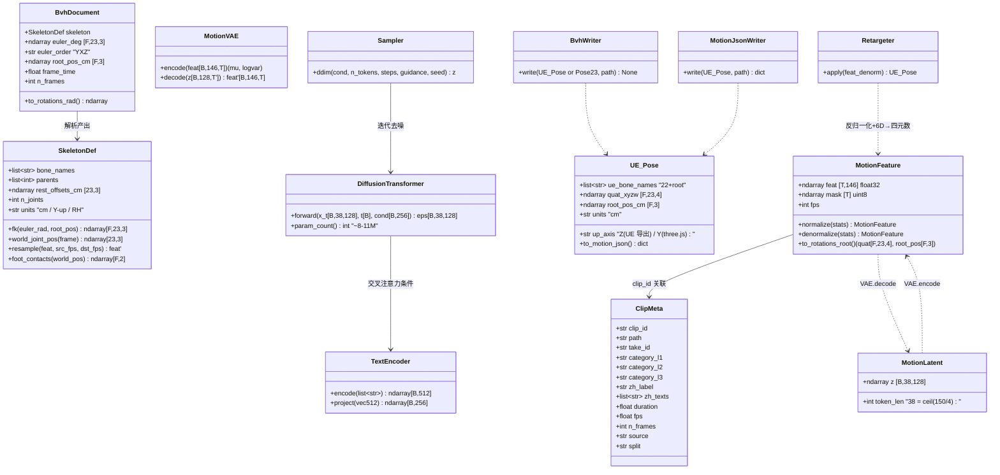
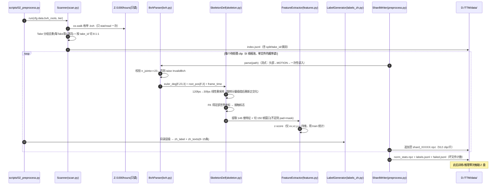
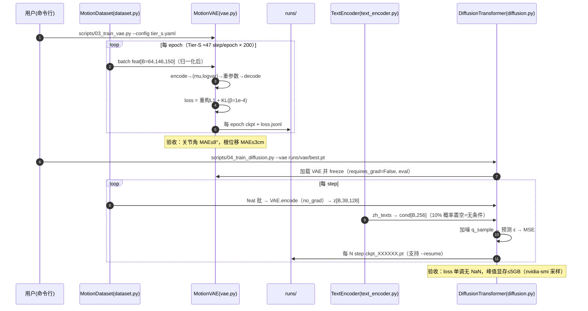
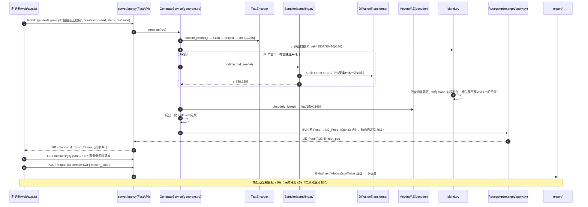
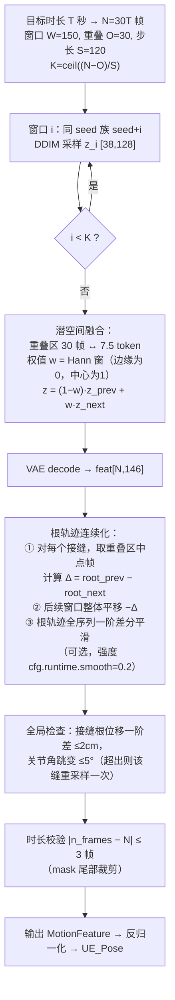
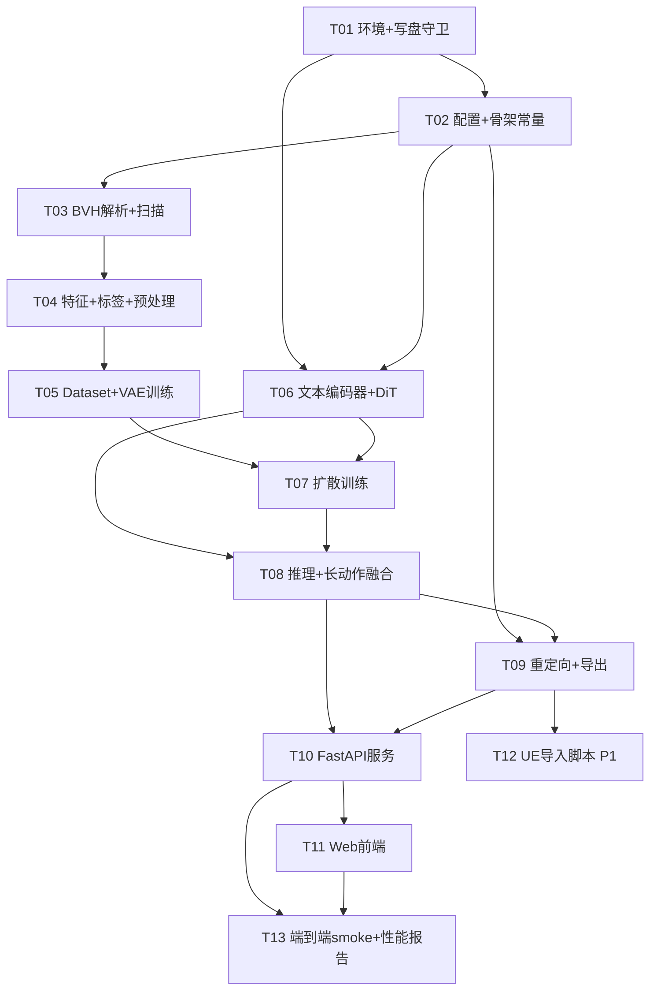

# TTM — 中文文本驱动骨骼动作生成系统 · 系统架构设计与任务分解

| 项 | 内容 |
|---|---|
| 文档版本 | v1.0 |
| 架构师 | 高见远（Bob） |
| 上游输入 | `TTM-PRD.md` v1.0 + 主理人技术决策（已锁定，不推翻） |
| 落盘路径 | `D:/TTM/deliverables/software-company/TTM-ARCH.md` |
| 关联图源 | `class-diagram.mermaid` / `sequence-diagram.mermaid`（同目录） |

---

# Part A · 系统设计

## 1. 实现思路（Implementation Approach）

### 1.1 核心技术难点与对策

| # | 难点 | 对策（本设计采纳） |
|---|---|---|
| D1 | **数据脏**：26k 文件中混有 root-only 轨迹文件（实测 `Take_207_stair_small_0.bvh` 全文仅 `ROOT stair_small_0` 6 通道、无任何 JOINT）、空 Take 目录、同 Take 多演员 | 扫描器**单趟流式**：目录枚举 → Take 分组去重（每 Take 取前 1 个演员）→ 解析头部**只数关节数**，`n_joints != 23` 直接淘汰并计入 `failed.jsonl`；坏文件跳过不中断 |
| D2 | **Z 盘网络盘随机读慢** | 预处理**单趟顺序读**（每文件一次 open → 全量读入 → 关闭，绝不回头二次读）；8 线程并发摊薄网络 RTT；产物全部落 D 盘，后续训练/推理**零次触碰 Z 盘** |
| D3 | **23 vs 22 骨骼不对齐**（BVH 4 节脊椎 vs UE 3 节） | BVH `Spine3` 的局部旋转**合并进 spine_03**：`q_ue_spine03 = q_bvh_Spine2 ⊗ q_bvh_Spine3`（四元数复合）。UE 侧多出的 `root` 骨保持恒等。见 §5.2 映射表 |
| D4 | **12 GB 显存内训完 VAE + 扩散** | 潜空间扩散（VAE 下采样 4×，150 帧 → 38 tokens），序列极短，8 层 d=256 Transformer 的激活内存约 0.2 GB（§10 公式），余量充足 |
| D5 | **中文条件**：24M 冻结 bge-small-zh + 小扩散模型易语义漂移（PRD R6） | CFG（guidance 3.0，训练期 10% 条件 dropout）+ 文本向量过 MLP 投影到 d=256；验收时跑「有条件 vs 无条件」对比 |
| D6 | **Python 3.13 + torch cu128 兼容性**（R4） | **先验证再写码**（T01 第一件事），失败降级路径见 §5.4 |
| D7 | **长动作**（武术套路 11,802 帧；用户要 12 秒） | 训练侧固定 150 帧窗口切片；推理侧滑窗 + 潜空间重叠融合 + 根轨迹平移对齐（§7 流程图） |
| D8 | **Python 端不解析 FBX**（R9） | 骨骼名映射表随设计交付；**rest pose delta 在消费端计算**（three.js FBXLoader / UE Python 均能读到权威绑定姿态），Python 端永远只输出 BVH 坐标系动画，彻底绕开 FBX 二进制解析/写出 |

### 1.2 框架选型与理由

| 选型 | 理由 |
|---|---|
| **PyTorch (CUDA 12.8 wheel)** | 唯一合理选择；自研轻量 VAE + DiT，代码量 < 1.5k 行，不需要 Lightning/accelerate |
| **MotionVAE：1D-Conv（Conv1d 栈）** | 时序局部性强、参数小（~3M）、下采样天然对齐「帧→token」；无需 einops，纯 `transpose/reshape` |
| **扩散：DDPM 训练 + DDIM 采样** | 标准做法；DDIM 50 步满足 ≤5s 时延；实现为纯 torch，无外部依赖 |
| **DiT（Transformer，d=256/8L/8H）** | 潜序列仅 38 tokens，注意力开销可忽略；交叉注意力吃文本条件，比 AdaLN 简单且够用 |
| **BAAI/bge-small-zh-v1.5（冻结）** | 主理人锁定；24M、512d、离线可跑，`HF_HOME` 重定向 D 盘 |
| **scipy.spatial.transform.Rotation** | 欧拉(YXZ)↔矩阵↔四元数唯一权威实现，不手写 |
| **FastAPI + uvicorn** | 单文件服务：`/generate` `/export/*` + 静态托管 `web/` 与 FBX |
| **前端：CDN ESM three.js，零构建链** | Node/npm 会写 C 盘 AppData，违反硬约束；`importmap` 引 three + FBXLoader，纯静态文件由 Python 托管 |
| **架构模式** | 分层管线：`data → models → train → infer → retarget/export → serve`，层间只通过 §5 的数据契约（npz/JSONL/Motion JSON）耦合 |

### 1.3 总体数据流

```
Z:/1000hours (只读, 只碰一次)
  │  scan(过滤/去重/8:1:1按Take切分) → index.jsonl
  │  parse(23关节校验) → 120fps→30fps重采样 → 特征(146维) → 归一化参数
  ▼
D:/TTM/data/shards/*.npz  +  labels.jsonl  +  norm_stats.npz
  ▼
MotionVAE(146→128潜, 4×下采样, 38 tokens) ──冻结──┐
  ▼                                              │
DiT 扩散 (38 tokens, d=256, 8L8H, ~8-11M) ◄───────┘解码
  ▲ 条件: bge-small-zh(冻结512d) → MLP → 256d
  ▼
特征序列 → 反归一化 → 6D→四元数 → FK/重定向 → UE_Pose
  ▼
three.js 预览 │ BVH 导出 │ Motion JSON │ tools/ue_import.py (UE 内建 AnimSequence)
```

---

## 2. 文件清单（File List，完整相对路径，根 = `D:/TTM/`）

```
D:/TTM/
├── pyproject.toml                      # 项目元数据 + 依赖声明（T01）
├── requirements.txt                    # 运行依赖（T01）
├── requirements.lock.txt               # pip freeze 锁定（T07 后生成）
├── .gitignore                          # runs/ data/ .cache/ (T01)
├── README.md                           # 运行手册：6 条命令跑通全流程（T01 骨架，T13 补全）
├── configs/
│   ├── default.yaml                    # 全量默认配置（T02）
│   ├── smoke.yaml                      # 超小冒烟档：10 类 × 5 条 ≈ 50 片段（T02）
│   └── tier_s.yaml                     # 首版正式档：≈3000 片段（T02）
├── src/ttm/
│   ├── __init__.py                     # 版本号（T01）
│   ├── common/
│   │   ├── __init__.py                 # （T01）
│   │   ├── paths.py                    # 路径解析 + 写盘守卫 assert_write_allowed()（T01）
│   │   ├── logutil.py                  # 统一 logger：控制台 + runs/logs/*.log（T01）
│   │   ├── seed.py                     # set_seed(seed)：random/numpy/torch/cuda（T01）
│   │   ├── config.py                   # load_config(path)+schema 校验（T02）
│   │   └── constants.py                # BONE_ORDER/PARENTS/REST_OFFSETS/UE_BONE_MAP/FEAT_LAYOUT（T02）
│   ├── data/
│   │   ├── __init__.py                 # （T02）
│   │   ├── skeleton.py                 # SkeletonDef：FK/重采样/世界坐标/接触检测（T02）
│   │   ├── bvh.py                      # BvhParser：流式解析+关节数校验（T03）
│   │   ├── scan.py                     # Scanner：目录枚举/Take去重/切分/index.jsonl（T03）
│   │   ├── features.py                 # FeatureExtractor：146 维特征+归一化（T04）
│   │   ├── labels_zh.py                # LabelGenerator：目录→中文→模板扩写（T04）
│   │   ├── preprocess.py               # PreprocessPipeline：单趟流式+分片落盘（T04）
│   │   └── dataset.py                  # MotionDataset：npz 分片随机读取+窗口采样（T05）
│   ├── models/
│   │   ├── __init__.py                 # （T05）
│   │   ├── vae.py                      # MotionVAE：Conv1d 编解码，latent 128，4×下采样（T05）
│   │   ├── text_encoder.py             # TextEncoder：bge 冻结 + MLP 512→256（T06）
│   │   └── diffusion.py                # DiffusionTransformer + DDPM/DDIM 调度（T06）
│   ├── train/
│   │   ├── __init__.py                 # （T05）
│   │   ├── train_vae.py                # train_vae(cfg)：重构+KL，ckpt/loss 落盘（T05）
│   │   └── train_diffusion.py          # train_diffusion(cfg)：CFG dropout，resume（T07）
│   ├── infer/
│   │   ├── __init__.py                 # （T08）
│   │   ├── sampling.py                 # Sampler：DDIM+CFG，seed 可复现（T08）
│   │   ├── blend.py                    # 长动作滑窗融合+根轨迹连续化（T08）
│   │   └── generate.py                 # GenerateService：文本→特征→Pose 全链路（T08）
│   ├── retarget/
│   │   ├── __init__.py                 # （T09）
│   │   ├── ue_map.py                   # 映射表加载/校验/Spine3 合并（T09）
│   │   └── apply.py                    # Retargeter：BVH系→UE_Pose（含轴向变换）（T09）
│   └── export/
│       ├── __init__.py                 # （T09）
│       ├── bvh_writer.py               # BvhWriter：标准 23 关节 BVH，30fps（T09）
│       └── motion_json.py              # MotionJsonWriter：ttm-motion/v1（T09）
├── scripts/
│   ├── env.ps1                         # PowerShell 环境变量注入（T01）
│   ├── env.sh                          # bash 同上（T01）
│   ├── 00_env_check.py                 # 环境/写盘守卫自检（T01）
│   ├── 01_scan.py                      # 生成 index.jsonl（T03）
│   ├── 02_preprocess.py                # 全量预处理→分片（T04）
│   ├── 03_train_vae.py                 # （T05）
│   ├── 04_train_diffusion.py           # （T07）
│   ├── 05_generate.py                  # 命令行生成+导出（T08）
│   └── 06_smoke_e2e.py                 # 端到端冒烟：中文→5s→HTTP→导出（T13）
├── server/
│   └── app.py                          # FastAPI：/generate /export/* /assets /web（T10）
├── web/
│   ├── index.html                      # 单页 UI + importmap(CDN three)（T11）
│   ├── app.js                          # FBX 加载/重定向应用/播放/UI 状态机（T11）
│   └── style.css                       # （T11）
├── tests/
│   ├── conftest.py                     # fixtures：迷你 BVH 字符串/假配置（T03 起）
│   ├── test_bvh.py                     # 解析/脏文件拒绝/重采样（T03）
│   ├── test_features.py                # 146 维布局/归一化往返/接触检测（T04）
│   ├── test_skeleton_map.py            # BONE_ORDER/parents/UE 映射 23 全覆盖（T02）
│   ├── test_vae_shapes.py              # VAE 编解码 shape/重构数值（T05）
│   ├── test_models.py                  # 文本投影/DiT 前向 shape+参数量（T06）
│   ├── test_sampling.py                # seed 复现/CFG shape/DDIM 步数（T08）
│   └── test_export.py                  # BVH 往返/Motion JSON schema/UE 映射应用（T09）
├── tools/
│   └── ue_import.py                    # UE Editor 内执行：Motion JSON→AnimSequence（T12，P1）
├── runs/                               # 运行期产物：ckpt/logs/samples（gitignore）
├── data/                               # 预处理产物：shards/index/labels/norm_stats（gitignore）
├── .cache/                             # pip/HF/torch/tmp 全部重定向至此（gitignore）
└── .venv/                              # Python 3.13.14（已建；失败降级见 §5.4）
```

> 说明：主理人清单中的 `src/ttm/data/skeleton.py` 职责明确为**运动学工具**（FK、重采样、接触检测、世界坐标），`bvh.py` 只做**文本解析**。新增 `tests/test_models.py` 与 `scripts/06_smoke_e2e.py` 两处超出主理人初版清单，已在上表标注。

---

## 3. 数据结构与接口（Class Diagram）

完整图源见 `class-diagram.mermaid`，核心如下：



---

## 4. 程序调用流（Sequence Diagrams）

### 4.1 时序图 A — 预处理链路



### 4.2 时序图 B — 训练链路（VAE 先训 → 冻结 → 扩散）



### 4.3 时序图 C — 推理链路



### 4.4 流程图 — 长动作滑窗 + 重叠融合 + 根位移连续化



---

## 5. 数据契约（工程师必须逐字实现）

### 5.1 共享约定

| 约定 | 内容 |
|---|---|
| **坐标系（内部）** | 全管线统一 **BVH 约定：Y-up、右手系、单位 cm**。训练特征、模型输入输出、BVH 导出全部此系。**轴向变换只存在于一个层**：`retarget/apply.py` 输出 UE_Pose 时做 `UE(x,y,z) = BVH(x, z, y)` + 手性翻转（ rotations 相应变换），three.js 预览仍直接消费 BVH 系（同为 Y-up RH），无需转换 |
| **旋转表示** | 内部统一 **6D 连续旋转表示**（旋转矩阵前两行，Zhou et al. 2019）；导出统一**四元数 [x,y,z,w]**（JPL/标量在后）。BVH 欧拉序：root 与关节均为 **YXZ**（实测 `CHANNELS 6 Xposition Yposition Zposition Yrotation Xrotation Zrotation` / `CHANNELS 3 Yrotation Xrotation Zrotation`），角度制，经 `scipy.Rotation.from_euler('YXZ', degrees=True)` 入内 |
| **单位** | 内部与导出统一 **cm**（源数据即 cm，Hips 高 ≈91.7cm），永不引入米 |
| **帧率** | 数据统一重采样到 **30fps**（120/4 精确整除，线性插值）；BVH 导出 `Frame Time: 0.0333333` |
| **随机种子** | `common/seed.py::set_seed(seed)` 同时设 `random/numpy/torch/torch.cuda`；同一 seed+同一指令+同一 ckpt ⇒ 逐帧 bit 级一致（推理固定 `torch.use_deterministic_algorithms` 不强求，但同机同版本必须复现，T08 有断言测试） |
| **错误处理** | 预处理：单文件任何异常 → `failed.jsonl` 追加 `{path, stage, error}` 计数后继续，失败率 >1% 时整批退出非零。推理：模型输出 NaN → 返回 HTTP 422 + 文案「换一个种子试试」 |
| **日志** | `common/logutil.py` 单例 logger，控制台 INFO + `runs/logs/{script}.log`；训练额外写 `runs/{vae,diffusion}/loss.jsonl`（每 step 一行） |
| **写盘守卫** | `common/paths.py::assert_write_allowed(p)`：白名单 `D:/TTM/**`；`paths.py` 提供 `resolve_out(path)` 供所有写文件处调用。`00_env_check.py` 用临时写入探针验证 TMPDIR/HF_HOME 等全部重定向 |
| **版本契约** | 特征布局带 `layout_version=1` 写进 norm_stats.npz 与 Motion JSON `meta`；布局变更必须升版本号 |

### 5.2 骨架常量与 UE 映射（`common/constants.py` + `retarget/ue_map.py`）

**BONE_ORDER（23，索引即数组维序，已按源 BVH 实测顺序锁定）：**

```
0 Hips            1 Spine           2 Spine1          3 Spine2
4 Spine3          5 Neck            6 Head
7 LeftShoulder    8 LeftArm         9 LeftForeArm    10 LeftHand
11 RightShoulder 12 RightArm       13 RightForeArm   14 RightHand
15 LeftUpLeg     16 LeftLeg        17 LeftFoot       18 LeftToeBase
19 RightUpLeg    20 RightLeg       21 RightFoot      22 RightToeBase
```

**PARENTS（长度 23，-1 为根）：**

```
[-1, 0, 1, 2, 3, 4, 5, 4, 7, 8, 9, 4, 11, 12, 13, 0, 15, 16, 17, 0, 19, 20, 21]
```

**UE_BONE_MAP（BVH → UE，22 骨 + root 特殊处理）：**

| BVH (idx) | UE 骨 | 备注 |
|---|---|---|
| Hips (0) | `pelvis` | 根位移写 pelvis（或 root 轨道，由 ue_import 决定） |
| Spine (1) | `spine_01` | |
| Spine1 (2) | `spine_02` | |
| Spine2 (3) | `spine_03` | |
| **Spine3 (4)** | **并入 `spine_03`** | **降级策略**：`q_ue_spine03 = q_bvh_Spine2 ⊗ q_bvh_Spine3`（四元数复合，右乘）；备选「各分 50%」留配置开关 `retarget.spine_merge: "fold"|"split"`，首版用 fold |
| Neck (5) | `neck_01` | |
| Head (6) | `head` | |
| LeftShoulder (7) | `clavicle_l` | |
| LeftArm (8) | `upperarm_l` | |
| LeftForeArm (9) | `lowerarm_l` | |
| LeftHand (10) | `hand_l` | |
| RightShoulder (11) | `clavicle_r` | |
| RightArm (12) | `upperarm_r` | |
| RightForeArm (13) | `lowerarm_r` | |
| RightHand (14) | `hand_r` | |
| LeftUpLeg (15) | `thigh_l` | |
| LeftLeg (16) | `calf_l` | |
| LeftFoot (17) | `foot_l` | |
| LeftToeBase (18) | `ball_l` | |
| RightUpLeg (19) | `thigh_r` | |
| RightLeg (20) | `calf_r` | |
| RightFoot (21) | `foot_r` | |
| RightToeBase (22) | `ball_r` | |
| （无） | `root` | UE 侧多出的轨道根，**恒等旋转、零位移**（动画整体平移写进 pelvis/root 轨道之一） |

> FBX on-disk 骨骼名与大小写（`clavicle_l` vs `clavicle_L`）**实现期必须实测**（T09 用 4 个 FBX 的字符串扫描输出校验报告，`tests/test_export.py` 断言 23/23 全命中），大小写不敏感匹配兜底。

**Rest pose 偏移（R3）**：Python 端**不做** delta 补偿——`retarget/apply.py` 只做名字映射+轴向+Spine3 合并；T-pose→A-pose 的每骨 delta 旋转在**消费端**计算（three.js 从 FBXLoader 读绑定姿态；UE 端 `tools/ue_import.py` 读骨骼 ref pose），映射表 JSON 中预留 `"rest_delta_hint"` 字段。此决策把 FBX 解析彻底挡在 Python 之外。

### 5.3 运动特征向量（**146 维**，精确定义）

**为什么是 146 而不是 PRD 估算的 260**：PRD 的 260 是立项前估算（23 关节旋转 138 + 关节位置/速度 + 根轨迹）。设计定稿时**删去关节世界位置与速度**（共 ~114 维）——它们可由旋转经 FK 完全推导，是冗余监督信号，只会摊薄 VAE 容量；保留**信息完备的最小集**：旋转（运动学完备）+ 根轨迹（全局摆放）+ 足接触（落地物理先验）。根关节旋转**不能漏**——以「去偏航倾斜 6D」表示（偏航单独走 sin/cos+角速度通道，避免角度回绕不连续）。每 clip 146×150×4B ≈ 87.6KB，Tier-M 全量 ≈ 1.05 GB float32。

| 维度区间 | 维数 | 内容 | 单位 | 归一化 |
|---|---|---|---|---|
| [0, 2) | 2 | 根**水平速度** (vx, vz)，**朝向系**（ heading 坐标下前/侧向） | cm/s | z-score |
| [2, 3) | 1 | 根**高度** y（骨盆世界高度） | cm | z-score |
| [3, 5) | 2 | **朝向** (sin θ, cos θ)，θ=偏航角，θ=atan2(前向.x, 前向.z) | rad | 无（天然有界） |
| [5, 6) | 1 | **偏航角速度** ω（中心差分） | rad/s | z-score |
| [6, 12) | 6 | **根倾斜 6D**：R_tilt = R_yaw⁻¹ · R_root 的前两行（保留俯仰/翻滚） | - | 无（每列单位范数） |
| [12, 144) | 132 | **22 个非根关节 × 6D 局部旋转**（相对父骨），顺序 = BONE_ORDER[1:]，由 YXZ 欧拉→旋转矩阵→取前两行 | - | 无 |
| [144, 146) | 2 | **足接触** (contact_L, contact_R) ∈ {0,1}：FK 得足部世界坐标，`高度<5cm 且 速度<15cm/s` 判 1，2 帧滞回 | - | 无 |

合计 **2+1+2+1+6+132+2 = 146 维**。布局以 `FEAT_LAYOUT` 常量（命名切片 dict）与 `layout_version=1` 双写进 `constants.py` 和 `norm_stats.npz`，测试逐段断言。

**norm_stats.npz**：`mean[146]`、`std[146]`（未归一化维为 0/1 恒等值）、`layout_version`；z-score 只作用 {0,1,2,5} 四个连续维，统计仅在 **train split** 上计算。

### 5.4 环境验证与降级（R4 结论）

**先验证再写码**。T01 第一条命令：

```powershell
. D:/TTM/scripts/env.ps1
pip install torch --index-url https://download.pytorch.org/whl/cu128
python scripts/00_env_check.py   # 断言 torch.cuda.is_available() 且 C 盘零写入
```

**失败降级路径**（写进 T01 验收）：下载 Python 3.12 embeddable/uv 托管版解压至 `D:/TTM/.uv/python/` → `D:/TTM/.uv/python/python.exe -m venv D:/TTM/.venv312` → 重跑 env_check。其余代码对解释器路径无假设（一律经 `scripts/env.ps1` 激活），切换 venv 零改动。

### 5.5 npz 分片格式（`data/tier_{tier}/shards/shard_{i:05d}.npz`）

| 字段 | dtype | shape | 说明 |
|---|---|---|---|
| `feat` | float32 | [n, 150, 146] | 归一化后特征，n≤512 |
| `mask` | uint8 | [n, 150] | 有效帧=1；不足 150 帧尾部 pad=0 |
| `clip_id` | `<U80` | [n] | `{root}/{take}_{actor}_{win:02d}` |
| `win_idx` | int16 | [n] | 窗口序号 |
| `layout_version` | int32 | 标量 | =1 |
| `fps` | int16 | 标量 | =30 |

窗口切法：源 clip 30fps 后按步长 150 非重叠切；尾窗 ≥75 帧保留（pad+mask），<75 丢弃。**shard_size=512**；训练端 `MotionDataset` 只做内存 map + 随机访问，不再触碰 Z 盘。

### 5.6 标签 JSON（`data/tier_{tier}/labels.jsonl`，每行一个 clip）

```json
{
  "clip_id": "1.7.3.3.Stairs_Up_Down/20260326/Take_207_stair_small_0_win00",
  "category_l1": "1.7.Daily_Life_Behavior",
  "category_l2": "1.7.3.Walking_Movement_With_Posture",
  "category_l3": "1.7.3.3.Stairs_Up_Down",
  "zh_label": "上楼梯",
  "zh_texts": ["上楼梯", "走上楼梯", "慢慢上楼", "一步一步上台阶", "踩着台阶往上走", "...8~15条"],
  "duration": 5.0,
  "fps": 30,
  "n_frames": 150,
  "source": "Z:/1000hours/BVH_Body/1.7.3.3.../Take_207_stair_small_0.bvh"
}
```

`index.jsonl`（scan 产物）每行：`{clip_id, path, take_id, split(train|val|test), zh_label, category_l1/l2/l3, n_frames, n_windows, source}`——**split 按 take_id 切**，train/val/test 的 take_id 无交集（测试断言）。`labels_zh.py` 内置 Tier-S ≥40 细类的中文映射表 + 每类 8–15 条模板变体；未映射类回退英文段名机械转写并 WARNING。

### 5.7 Motion JSON Schema（`ttm-motion/v1`，导出层 P0-A）

```json
{
  "format": "ttm-motion/v1",
  "fps": 30,
  "n_frames": 150,
  "skeleton": "bvh23",
  "bone_names": ["Hips", "Spine", "...", "RightToeBase"],
  "parents": [-1, 0, 1, 2, 3, 4, 5, 4, 7, 8, 9, 4, 11, 12, 13, 0, 15, 16, 17, 0, 19, 20, 21],
  "rest_offsets_cm": [[0,0,0], ["x","y","z"], "...共23行"],
  "units": { "length": "cm", "rotation": "quaternion_xyzw", "up_axis": "Y", "handedness": "right" },
  "root_pos": [[0.0, 91.7, 0.0], "...F行"],
  "rotations_quat": [[[qx,qy,qz,qw], "×23骨"], "×F帧"],
  "meta": { "prompt": "慢慢走上楼梯", "seed": 42, "ckpt": "runs/diffusion/ckpt_004000.pt", "duration_s": 5.0, "layout_version": 1 }
}
```

消费端（three.js / `tools/ue_import.py`）凭 `units` 自行做轴向/手性变换与 rest delta。

### 5.8 `config.yaml` 完整字段表

| 字段 | 类型/默认 | 说明 |
|---|---|---|
| `project.root` | str `D:/TTM` | 写盘守卫白名单根 |
| `project.cache_dir` | str `D:/TTM/.cache` | PIP/HF/TORCH/TMP 重定向基准 |
| `project.runs_dir` / `project.data_dir` | str `runs/` / `data/` | 产物根 |
| `data.tier` | enum `S\|M\|L` | 选择 labels/扫描范围档位 |
| `data.bvh_roots` | list[str] | `["Z:/1000hours/BVH_Body", "Z:/1000hours/4.wushu"]`（Tier-S 仅前者） |
| `data.include_categories` | list[str] \| null | Tier-S 用：40 细类前缀白名单；null=全量 |
| `data.fps` / `window` / `overlap` | 30 / 150 / 30 | 生成侧窗口参数同源 |
| `data.min_tail_frames` | 75 | 尾窗保留阈值 |
| `data.actors_per_take` | 1 | Take 去重保留演员数 |
| `data.max_files` | 3000 | 上限保护 |
| `data.val_ratio` / `test_ratio` | 0.1 / 0.1 | 按 take_id 切分 |
| `data.shard_size` | 512 | npz 分片 |
| `motion.n_joints` / `feature_dim` | 23 / **146** | 契约常量，config 中只读校验 |
| `motion.contact_height_cm` / `contact_speed_cmps` | 5 / 15 | 接触检测阈值 |
| `vae.latent_dim` / `hidden` / `downsample` | 128 / 512 / 4 | 4× 下采样 → T'=38 tokens |
| `vae.epochs` / `batch_size` / `lr` / `kl_weight` | 200 / 64 / 2e-4 / 1e-4 | |
| `diffusion.d_model` / `n_layers` / `n_heads` | 256 / 8 / 8 | ~8-11M 参数 |
| `diffusion.timesteps` / `ddim_steps` | 1000 / 50 | DDPM 训练 / DDIM 推理 |
| `diffusion.epochs` / `batch_size` / `lr` | 100 / 64 / 1e-4 | |
| `diffusion.cfg_dropout` | 0.1 | 条件随机置空率 |
| `text.encoder` / `frozen` / `max_len` / `proj_dim` | `BAAI/bge-small-zh-v1.5` / true / 32 / 256 | HF 离线加载 |
| `runtime.seed` / `precision` / `device` | 42 / `bf16` / `cuda` | bf16 autocast + fp32 主权重 |
| `runtime.guidance` / `smooth` | 3.0 / 0.2 | CFG 强度 / 根轨迹平滑 |
| `runtime.vae_ckpt` / `runtime.diffusion_ckpt` | str | 推理加载路径 |
| `serve.host` / `serve.port` / `serve.max_duration_s` | 127.0.0.1 / 8765 / 12 | 时长档 3/5/8/12 |
| `retarget.spine_merge` | `fold` \| `split` | Spine3 降级策略开关 |

`common/config.py` 职责：读取 → 与上述 schema 校验（类型/枚举/互斥）→ dataclass 暴露 → 任何脚本启动时把**最终生效配置** dump 到 `runs/<name>/config_resolved.yaml`（可复现性）。

---

## 6. 依赖包清单（Required Packages）

| 包 | 版本策略 | 为什么需要 |
|---|---|---|
| `torch` | cu128 稳定通道（`--index-url .../whl/cu128`），装最新稳定版后锁进 lock 文件 | 唯一深度学习框架；R4 先验证 |
| `numpy` | `>=2.1,<3` | 数值主载体；注意与 torch 版本 ABI 兼容（lock 固化） |
| `scipy` | `>=1.14` | **仅用** `spatial.transform.Rotation`（欧拉↔矩阵↔四元数权威实现）+ 线性插值 |
| `transformers` | `>=4.44` | 加载 bge-small-zh-v1.5（AutoModel/AutoTokenizer），离线模式 |
| `safetensors` | 随 transformers | ckpt 安全序列化（自研权重也存 safetensors） |
| `tokenizers` | 随 transformers | bge 分词（被动依赖，无网络运行需缓存齐全） |
| `pyyaml` | `>=6` | config 加载 |
| `fastapi` + `uvicorn` | `>=0.110` / `>=0.29` | 推理服务 + 静态托管 |
| `tqdm` | `>=4.66` | 预处理/训练进度 |
| `orjson` | `>=3.10` | index/labels JSONL 高速读写（3000+ 行×多字段，std json 慢 5-10×） |
| `pytest` | `>=8`（dev） | 测试 |
| **明确不引入** | — | `einops`（reshape 可完全替代）、`lightning/accelerate`（手工训练循环足够）、`scikit-learn`（切分手写）、`trimesh/pyfbx`（FBX 不在 Python 侧解析）、`smplx`、前端构建链 |

依赖总数 **11 个直接依赖**，全部纯 pip 可装、全部可重定向缓存到 `D:/TTM/.cache`。

---

## 7. 性能预算（Performance Budget）

### 7.1 预处理（Tier-S ≈3000 片段，Z 网络盘）

| 项 | 估算 | 依据 |
|---|---|---|
| 单文件 | 1–1.5s | 平均 ~1MB 顺序读 0.3–1s + 解析/重采样/特征 ~0.3s（np.fromstring 一次性向量化，逐行 parse 是禁手） |
| 并发 | 8 线程 | 网络盘 RTT 摊薄；实测高于 16 线程收益递减（T04 落地时打印吞吐曲线） |
| **总耗时目标** | **20–35 分钟**（上限 60 分钟） | 3000 × 1.2s ÷ 8 ≈ 8 min 理想；×3 安全系数 |
| 产物体积 | ~0.4 GB | 3000 clip × 87.6KB + shards 冗余 |

### 7.2 训练（3080 Ti，bf16）

| 阶段 | 规模 | 每 epoch | epochs | 总时长 |
|---|---|---|---|---|
| VAE | 3000 窗口, batch 64 → 47 step | ~4s | 200 | **~15–25 min**（验收线 ≤40min） |
| 扩散 | 3000 样本, batch 64 → 47 step | ~15s（47 step × ~0.3s） | 100 | **~20–40 min**（验收线 ≤60min） |

> 加上 3–5 分钟 smoke 档全链预演，Tier-S「2–3 小时出第一版」目标成立。

### 7.3 单次推理时延分解（5 秒动作，热启动）

| 步骤 | 耗时 |
|---|---|
| 文本编码（24M，fp16） | ~15 ms |
| DDIM 50 步 × CFG 双前向（38 tokens，8M 模型） | ~0.8–1.5 s |
| VAE 解码 150 帧 | ~30 ms |
| 反归一化 + 6D→四元数 + 重定向 | ~20 ms |
| 序列化 + HTTP | ~50 ms |
| **合计** | **~1–2 s**（PRD 上限 10s，采样上限 5s，余量大） |

### 7.4 峰值显存估算

**激活 ≈ B × T′ × d × L × k × bytes**，k≈20（attn+FFN 中间量+残差的经验系数，bf16=2B）：

```
扩散训练:  64 × 38 × 256 × 8 × 20 × 2B ≈ 0.16 GB
优化器:    11M 参数 × (4B权重 + 4B动量 + 4B方差 + 4B主权重) ≈ 0.18 GB
梯度:      11M × 2B(bf16) ≈ 0.02 GB
VAE 冻结前向: ~0.05 GB   文本编码器 fp16: ~0.05 GB
CUDA 上下文/碎片: ~0.5 GB
─────────────────────────────────────
训练峰值 ≈ 1.0–1.5 GB  ≪ 5 GB 上限（可放心把 batch 提到 128/256）
推理峰值:  权重(bge 50M×2B + DiT 8M + VAE 3M ≈ 0.12GB) + 激活(50步×2前向, <10MB)
         + CUDA 上下文 0.5GB ≈ 0.7–1.0 GB ≪ 2.5 GB
```

结论：显存不是瓶颈，`perf_report.md` 记录实测峰值即可；余量留给后续 Tier-M 扩量。

---

## 8. 首版明确不做（Not in v1）

| 项 | 原因 |
|---|---|
| 自研 FBX 二进制 writer（P2） | 消费端脚本（ue_import.py）方案更稳，见 R8 结论 |
| P1-01 部位控制 / P1-02 曲线面板 / P1-04 双指令过渡 / P1-06 动作库浏览 / P1-07 CPU 回退（仅做 OOM 报错提示） | 首版聚焦 P0 15 条 |
| 武术**段落级**生成（P1-03） | 武术数据 Tier-L 才入训；首版 `labels_zh.py` 预置武术模板但不参与训练 |
| Tier-M / Tier-L 训练 | 只保证配置切换无需改码（`data.tier`） |
| VRM / 表情 / 物理 / SMPL / LLM 对话 / 实时流式 | PRD §9 已排除 |
| einops 及一切重型依赖 | §6 |

---

## 9. 待澄清与假设（Anything UNCLEAR）

1. **潜 token 数**：主理人快照写「下采样 4 倍→30 tokens」，但 150/4=37.5 → Conv1d 实际输出 **T′=38**（padding 后 152/4=38）。本设计按 38 定契约（测试断言），对模型规模/显存无实质影响。若坚持 30 tokens，需把窗口改 120 帧——**不建议**，150 帧=5s 是 PRD 明确锚点。
2. **FBX on-disk 骨骼名大小写**（R9）：字符串扫描未确认 `clavicle_l` vs `clavicle_L`；T09 以实测为准，映射器做大小写不敏感兜底。
3. **UE rest pose 的 A-pose delta** 具体数值需在 UE/three.js 端实测后回填 `ue_map.json` 的 `rest_delta_hint`；首版预览允许轻微手臂姿态差，不做 IK（PRD §9 排除）。
4. **Torch cu128 对 3.13 的 wheel 覆盖**：假设主cuda通道近期已支持；T01 的验证命令是唯一裁决，降级路径已备。
5. **Spine3 fold 的质量影响**：fold 会把两节脊椎自由度压进一节，弯腰极限略降；`retarget.spine_merge: split` 开关保留实验空间。
6. **假设**：Tier-S 40 细类的中文映射表由 labels_zh.py 内置硬编码（~40 行表数据），如需人工精标（PRD R1）另行追加，不阻塞架构。

---

# Part B · 任务分解

## 10. 任务列表（13 条，按依赖序）

| ID | 任务名 | 产出文件（相对 `D:/TTM/`） | 依赖 | 优先级 | 验收标准（可执行/可断言） | 代码量 |
|---|---|---|---|---|---|---|
| **T01** | **环境自检 + venv/依赖 + 写盘守卫** | `scripts/env.ps1` `scripts/env.sh` `scripts/00_env_check.py` `pyproject.toml` `requirements.txt` `.gitignore` `README.md`(骨架) `src/ttm/__init__.py` `src/ttm/common/{__init__,paths,logutil,seed}.py` | — | P0 | ① `pip install torch --index-url .../cu128` 成功（失败则按 §5.4 降级 3.12 并记录）；② `python scripts/00_env_check.py` 退出码 0：torch.cuda 可用+跑通一次 GPU 矩阵乘、`PIP_CACHE_DIR/HF_HOME/TORCH_HOME/TMPDIR` 全指向 `D:/TTM/.cache`、临时写探针证明 C 盘零写入；③ `assert_write_allowed("C:/x")` 抛异常、`D:/TTM/...` 放行（单测） | ~450 行 |
| **T02** | **配置系统 + 骨架常量（数据契约核心）** | `configs/{default,smoke,tier_s}.yaml` `src/ttm/common/{config,constants}.py` `src/ttm/data/{__init__,skeleton}.py` `tests/test_skeleton_map.py` | T01 | P0 | ① `load_config` 对 §5.8 全字段校验，坏配置报错清晰；② constants：BONE_ORDER 23 名与实测序一致、PARENTS 长度 23 且无环、UE_BONE_MAP 22+root 全覆盖（测试断言）；③ SkeletonDef.resample 把 120fps 合成信号降到 30fps 后逐点误差 <1e-3；FK 于 rest pose 重建 offsets 误差 <0.01cm | ~550 行 |
| **T03** | **BVH 解析器 + 扫描索引** | `src/ttm/data/{bvh,scan}.py` `tests/test_bvh.py` `tests/conftest.py` `scripts/01_scan.py` | T02 | P0 | ① 解析 `wuda_017_Skeleton1.bvh`（23 关节，11,802 帧）成功，euler/root_pos shape 正确；② 解析实测 root-only 文件（6 通道）抛 `InvalidBvh` 并给出 reason；③ `01_scan.py` 产出 `data/tier_S/index.jsonl`：take_id 去重生效、三集 take_id 无交集（断言）、空 Take 目录自动跳过 | ~550 行 |
| **T04** | **特征提取 + 中文标签 + 全量预处理** | `src/ttm/data/{features,labels_zh,preprocess}.py` `tests/test_features.py` `scripts/02_preprocess.py` | T03 | P0 | ① 特征 shape (T,146) 且各段切片符合 §5.3 布局（逐段断言）；6D 段每对列模长 1±1e-5；② 归一化→反归一化往返误差 <1e-6；③ 接触检测在站立 clip 上 foot 段 contact≈1；④ `02_preprocess.py` 对 Tier-S 跑完：shards 可被 numpy 读回、`failed.jsonl` 失败率 ≤1%、`norm_stats.npz` 含 layout_version、全程**不再读 Z**（scan 后索引已知路径，运行期用文件监视断言） | ~800 行 |
| **T05** | **数据集加载 + MotionVAE + VAE 训练** | `src/ttm/data/dataset.py` `src/ttm/models/{__init__,vae}.py` `src/ttm/train/{__init__,train_vae}.py` `tests/test_vae_shapes.py` `scripts/03_train_vae.py` | T04 | P0 | ① Dataset 随机抽 batch：feat [64,146,150] 且 mask 生效（pad 帧 loss 置零）；② VAE encode/decode shape (B,38,128)/(B,146,150) 断言；③ smoke.yaml（50 clip）10 epoch loss 下降 >30%；④ Tier-S 训练 ≤40min：关节角 MAE ≤8°、根位移 MAE ≤3cm（用 val 集算），ckpt 落 `runs/vae/best.pt` | ~600 行 |
| **T06** | **文本编码器 + 扩散 Transformer** | `src/ttm/models/{text_encoder,diffusion}.py` `tests/test_models.py` | T01, T02 | P0 | ① bge 从 `HF_HOME`(D 盘) 离线加载（断网断言通过）；「上楼梯/上楼」cos>0.7，「上楼梯/打拳」cos<0.4；投影输出 [B,256]；② DiT 前向 shape [B,38,128]→[B,38,128]；参数量打印且 ∈[8M,12M]；③ 同输入两次前向 dropout 关闭时输出一致 | ~550 行 |
| **T07** | **扩散训练（DDPM + CFG dropout + resume）** | `src/ttm/train/train_diffusion.py` `scripts/04_train_diffusion.py`（生成 `requirements.lock.txt`） | T05, T06 | P0 | ① loss.jsonl 无 NaN 且后 20% 均值 < 前 20% 均值；② 每 N step ckpt + `--resume` 中断续跑后 loss 曲线连续；③ 后台 `nvidia-smi` 采样峰值 ≤5 GB 并写入 `runs/diffusion/vram_peak.txt`；④ 有/无条件训练判别：CFG 置空分支确实被触发（日志计数>0） | ~400 行 |
| **T08** | **推理采样 + 长动作融合 + 生成服务层** | `src/ttm/infer/{__init__,sampling,blend,generate}.py` `tests/test_sampling.py` `scripts/05_generate.py` | T06, T07 | P0 | ① 同 seed+同指令两次生成逐帧 allclose（<1e-6）；② 150 帧 DDIM50 端到端 ≤5s（计时断言，允许 ±20% 容差）；③ 12s（360 帧）生成：接缝根位移一阶差 ≤2cm、关节角跳变 ≤5°（断言）；④ 时长 3/5/8/12s 帧数误差 ≤3 帧；⑤ 推理峰值显存 ≤2.5 GB（记录）；⑥ NaN 输入指令触发可控错误路径 | ~600 行 |
| **T09** | **重定向 + 双格式导出** | `src/ttm/retarget/{__init__,ue_map,apply}.py` `src/ttm/export/{__init__,bvh_writer,motion_json}.py` `tests/test_export.py` | T02, T08 | P0 | ① 映射器对 4 个本地 FBX 做骨骼名字符串扫描，输出报告 23/23 命中（大小写兜底计入）；② Spine3 fold：复合后 spine_03 四元数与手算一致；③ BVH 导出文件 head 与源 BVH 层级同构（关节名/顺序一致）、150 帧 <1MB、可被 Blender 导入（人工验收一次并记录）；④ Motion JSON 通过 schema 校验且 roundtrip（读回→重写）字节级稳定 | ~600 行 |
| **T10** | **FastAPI 推理服务** | `server/app.py` | T08, T09 | P0 | ① `uvicorn` 启动后 `POST /generate`（含非法入参 422 路径）返回 motion_id；② `GET /motions/{id}.json` 可拉取；③ `POST /export bvh` 返回合法 BVH 字节流；④ 静态托管 `/`（web）与 `/assets/*.fbx`（4 个 FBX）；⑤ `/health` 报告显存占用 | ~300 行 |
| **T11** | **浏览器预览前端（零构建链）** | `web/{index.html,app.js,style.css}` | T10 | P0 | ① importmap CDN 加载 three+FBXLoader，4 个 FBX 可切换；② 生成→加载 motion json→骨骼套用播放，150 帧 @1080p ≥55fps（rAF 计时显示）；③ 播放/暂停/进度 scrub、时长 3/5/8/12、seed/steps/guidance 输入、错误态文案齐备（§7.3 UI 状态机全覆盖） | ~700 行 |
| **T12** | **UE 导入脚本**（P1） | `tools/ue_import.py` | T09 | P1 | ① 在 UE5 Editor Output Log `py` 执行：读 Motion JSON → `AnimationSequence` 逐帧写 bone transform（Spine3 fold、root/pelvis 轨道、轴向变换内建）；② README 记录操作步骤与验收截图路径；③ 无 UE 环境时提供空跑模式（解析 JSON 并打印将写入的轨道清单） | ~250 行 |
| **T13** | **端到端 smoke + 性能报告** | `scripts/06_smoke_e2e.py` `deliverables/perf_report.md` `README.md`(补全) | T10, T11 | P0 | ① `06_smoke_e2e.py`：启动服务→POST「慢慢走上楼梯」5s→轮询完成→下载 BVH→断言帧数≥149 且文件头合法，总耗时（热启动）≤10s 并打印分解；② `perf_report.md` 收录：预处理/VAE/扩散耗时、训练与推理 VRAM 峰值实测、单次推理时延分解表、nvidia-smi 截图路径；③ README 六条命令从零复现全流程 | ~250 行 |

## 11. 任务依赖图



关键并行点：T06 只依赖 T01/T02，可在 T03–T05 数据管线进行期间**并行开发**；T11 前端可基于 §5.7 Motion JSON 契约先行 mock 开发。

## 12. 共享知识（Shared Knowledge，跨文件契约速查）

1. 一切旋转内部 6D、导出四元数 **xyzw**；欧拉序一律 **YXZ 角度制**（仅解析边界处理一次）。
2. 坐标系内部 **BVH(Y-up/RH/cm)**；唯一轴向变换点在 `retarget/apply.py`；three.js 直接吃 BVH 系。
3. 特征 **146 维**、布局 `layout_version=1`（§5.3 表格即权威定义，`FEAT_LAYOUT` 常量是唯一实现处）。
4. 所有落盘路径必须经 `paths.resolve_out()`（写盘守卫）；所有随机性经 `seed.set_seed()`。
5. 所有 JSONL 用 orjson 逐行读写；npz 字段名/dtype 见 §5.5，不得增删字段（加字段需升 layout_version）。
6. 坏文件：捕获 → `failed.jsonl` → 计数 → 继续；任何脚本不得因单文件失败退出。
7. 训练产物目录约定：`runs/{vae,diffusion}/{ckpt_*.pt, loss.jsonl, config_resolved.yaml}`；数据产物：`data/tier_{tier}/{shards/, index.jsonl, labels.jsonl, failed.jsonl, norm_stats.npz}`。
8. 日志双写（控制台 + `runs/logs/`）；每个脚本 `--config` 参数指向 `configs/*.yaml`，无硬编码路径。

---

*文档结束 · v1.0 · 架构师 高见远*
